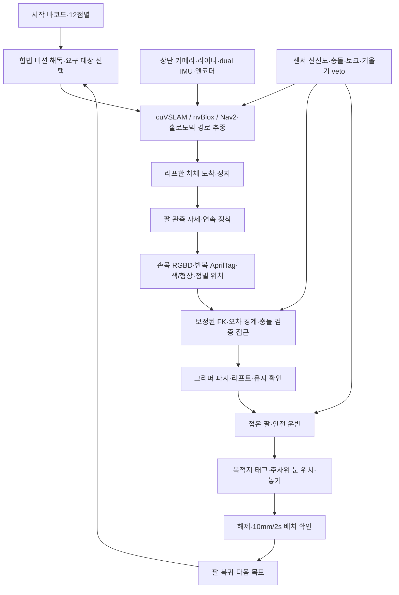
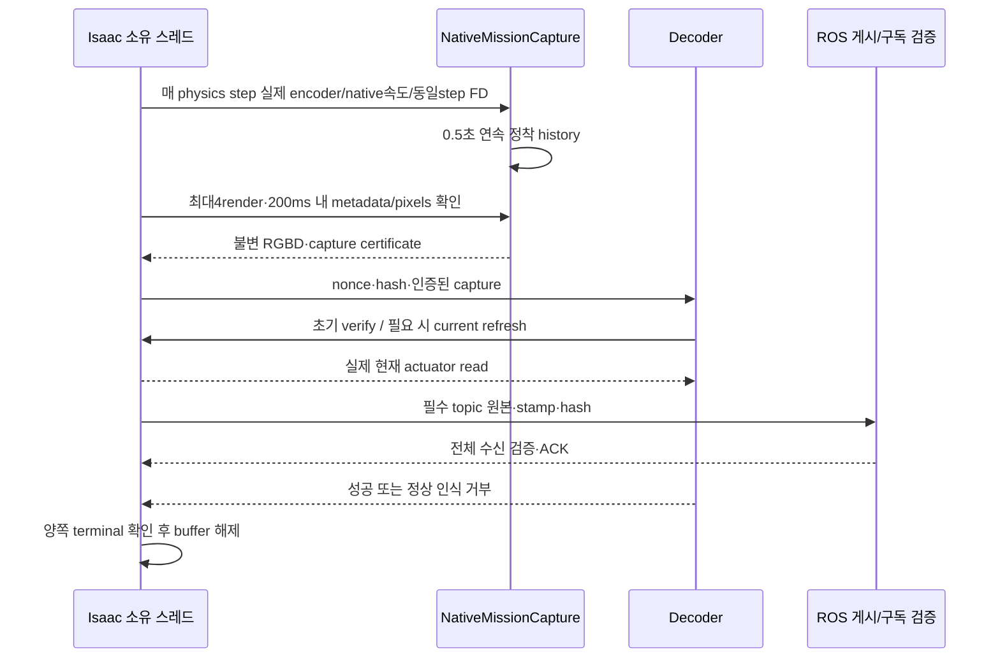

# R12 아키텍처

## 목표 시스템

이는 목표 흐름이다. 모든 화살표가 통합 실행으로 검증된 것은 아니다. 현재 핵심 공백은 전체 센서 runtime 연결, 실제 카메라·그리퍼 보정, 미로 장애물 전체 coverage, 배치 자세 변환, 파지/운반 연결 및 정상 종료다.

## 관측과 현재 피드백의 분리

- 과거 촬영 FK와 최신 actuator 피드백은 별개다. ACK 시각을 촬영 시각으로 바꾸지 않는다.
- ReferenceTime은 렌더 기준 rational time이다. 실제 노출 시각이나 벽시계로 간주하지 않는다.
- 같은 호스트 IPC peer UID/PID·nonce·digest·재전송 거부, bounded framing, 실제 current read를 유지한다.
- 정상 인식 거부도 terminal 결과다. 성공으로 바꾸지 않고 다음 재관측으로 넘어간다. 통신 오류는 buffer/증거를 보존하고 새 관측을 막는다.
- GC는 정지·zero command·pending 없음·원본 상태 불변 조건에서 다음 history timestamp **이전**에만 수행한다.

## 코드 지도

| 경로 (`r12/` 기준) | 책임 |
|---|---|
| `src/arm_practice/native_rgbd/` | 캡처, encoder history, settling, FK, 인증 관측, 수명 관리 |
| `src/arm_practice/` | 미션·주행·인식·집기놓기 관련 코어 |
| `scripts/` | headless 시뮬레이션·분석·평가 실험 진입점 |
| `configs/` | 로봇·카메라·액추에이터·미션 계약 |
| `models/` | 주행/팔 정책, 인식 가중치, URDF/USD·scene |
| `assets/vendor/` | 참조 CAD/미로 자산 |
| `ros2/` | 팔 MoveIt 설정 등 기존 ROS 연동 |
| `experiments/pa24-v44/` | 검증된 5카메라 ready bench 소스 |
| `experiments/pa24-v45-unverified/` | 8RGB4depth 연결 준비본, 미실행 |
| `experiments/pa33-v135/` | 검증된 IPC/ROS observer 소스; 외부 모델·fixture 의존 |
| `experiments/pa28-v152/` | 종료 실패를 보존한 물리 smoke 소스, 합격 모델 아님 |

## 실행 분리

현재 로컬만 실행한다. 원격 재개 승인 시의 예약 allocation은 local87/표시88, pa24 24/25, pa33 33/34, pa28 28/29이며 DDS는 호스트 사이를 연결하지 않는다. 파일·포트·모델·실험 잠금은 호스트별 분리한다. 이 allocation 표는 현재 원격 기동 권한이 아니다.
