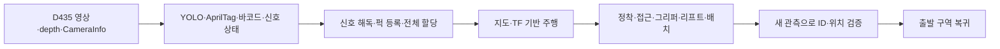

# 개인 기여 기록

## 정수용 (`affluentmind12`)

맡은 일은 크게 네 가지였다. 시스템 데이터 흐름 설계(v3), Isaac Lab 로봇팔 집기·적재 시뮬레이션, Nav2 자율주행(시뮬에서 만들고 Jetson으로 이식), 카메라·태그 인식 진단(PA24).

- 담당 Issue: [#12](https://github.com/KANT-PA1-Project/lv2-nz2-project2/issues/12) 데이터 흐름 v2→v3 (닫힘), [#28](https://github.com/KANT-PA1-Project/lv2-nz2-project2/issues/28) PA24 실물 pad/TCP·카메라 보정 (진행 중)
- 개인 작업 일지는 팀 노션에 따로 정리했다.
- 기능 시험은 전부 시뮬레이션(Isaac Lab 6.1, Gazebo + Nav2)에서 했다. 실물은 Jetson 빌드와 라이다 1대 수신까지만 확인했고, 실물 주행이나 집기 시험은 시간이 부족해 하지 못했다.

### 1. 구현

| PR | 내용 | 병합 |
|---|---|---|
| [#13](https://github.com/KANT-PA1-Project/lv2-nz2-project2/pull/13) | 데이터 흐름 v3 설계도 `docs/nz2_dataflow_v3.html` | 10/23 |
| [#18](https://github.com/KANT-PA1-Project/lv2-nz2-project2/pull/18) | 로봇팔 가동범위 측정 도구 `tools/arm_motor_range_check/` | 10/30 |
| [#29](https://github.com/KANT-PA1-Project/lv2-nz2-project2/pull/29) | PA24 카메라·태그 인식 작업 (tutor 브랜치 병합, 내 커밋은 `ddc81fe`, `6217387`) | 11/17 |
| [#30](https://github.com/KANT-PA1-Project/lv2-nz2-project2/pull/30) | 로봇팔 집기·적재통 넣기 시뮬, 실험 001~043 | 11/17 |
| [#53](https://github.com/KANT-PA1-Project/lv2-nz2-project2/pull/53) | 전체 로봇 URDF로 시뮬 전환, 실험 044~070 (#30 브랜치에 먼저 합친 뒤 #30과 함께 main 반영) | 11/17 |
| [#50](https://github.com/KANT-PA1-Project/lv2-nz2-project2/pull/50) | 실물 Nav2 패키지 `nz2_swerve_nav`, Jetson 인계 문서 | 11/17 |
| [#52](https://github.com/KANT-PA1-Project/lv2-nz2-project2/pull/52) | 시뮬 지도 4종, Nav2 시험 결과 12건 | 11/17 |
| [#54](https://github.com/KANT-PA1-Project/lv2-nz2-project2/pull/54) | Gazebo 미로 월드, 시뮬 URDF, 생성 스크립트 `sim/gazebo_nz2/` | 11/17 |

**데이터 흐름 v3 (#13)**
v2에서는 경로 추종 노드를 직접 만들 계획이었는데, 직접 짜야 할 코드를 줄이려고 Nav2 MPPI(Omni)를 쓰는 쪽으로 바꿨다. 스월브 계산·통신·안전 기능은 `swerve_driver.cpp` 하나로 합쳤고, 적재통 관리는 `planning_master` 안으로 넣었다. 그 결과 `path_tracker`, `swerve_kinematics`/`swerve_bridge`, `bin_manager`가 빠졌다. 퍽 위치를 넘길 `/perception/puck_map`과 정지 원인을 알려 줄 `/safety/state`는 새로 추가했다. 주행 명령은 `control_master`, `velocity_smoother`, `collision_monitor`, `swerve_driver` 순으로 한 줄로 정리했고, 이후 팀이 노드를 나눠 맡을 때 이 그림을 기준으로 썼다.

**가동범위 측정 도구 (#18)**
팔 모터(ID 11~16)의 토크를 끄고 손으로 돌리면서 최소·최대 각도를 CSV로 남기는 웹 대시보드다. 모터에는 토크 OFF만 쓰고 위치나 EEPROM은 건드리지 않게 했다. 이 도구로 잰 값이 #20의 관절 한계(joint1 ±175°, joint2 −95~+113° 등)로 확정됐고, 리뷰할 때 리뷰어(`pizzaafterhangover`)와 같이 실제로 돌려 봤다.

**로봇팔 집기·적재 시뮬 (#30, #53)**
IK 상태기계로 퍽을 집어 적재통에 넣는 동작을 만들고, 조건을 바꿔 가며 실험 70회를 돌렸다. 실험마다 256 에피소드씩 했고, 인식 오차는 편향 6 mm, 재관측 후 2 mm, z 2 mm로 넣었다.

| 작업 | 조건 | 실험 | 성공률 |
|---|---|---|---|
| 집기 | 팔만, 인식 오차 있음 | 045 | 100 % |
| 집기 | 전체 로봇, 인식 오차 있음 | 067 | 98.0 % |
| 누운 퍽 세워 적재통에 넣기 | 인식 오차 있음, 쥐는 점 14 mm | 043 | 93.4 % |
| 세운 퍽 칸에 넣기 | 전체 로봇, 인식 오차 없음 / 있음 | 069 / 070 | 71.1 % / 52.7 % |

컵 바닥을 0.30 m로 올리면 세운 퍽은 넣을 수 없다는 것도 여기서 확인했다(실험 042, 0 %). 이 결과는 최종 URDF의 적재통 높이를 정할 때 넘겼다.

**Nav2 자율주행 (#50, #52, #54)**
스월브용 Nav2 패키지 `nz2_swerve_nav`를 만들었다. 라이다 4대를 합쳐 AMCL로 위치를 잡고 MPPI로 주행하며, 실물과 시뮬을 같은 launch로 띄운다. 스월브가 작은 명령에도 바퀴 방향을 계속 돌리는 문제가 있어서, `cmd_frame_adapter.py`에 데드밴드와 정렬 게이트를 넣었다. 정렬 게이트는 바퀴가 목표 방향으로 다 돌기 전에는 속도를 줄이는 기능이다. 행동 트리에서는 Spin·BackUp을 뺐고, `nav_goal_test.py`로 시험 결과를 자동으로 모으게 했다. Gazebo 월드와 시뮬 URDF는 원래 내 PC에만 있었는데, #54로 저장소에 올려서 다른 팀원도 시뮬을 돌릴 수 있게 했다.

**PA24 태그 인식 (#29 중 내 커밋 2건)**
`ddc81fe`에서는 RGB-D로 태그 ID를 판별할 때 모호한 ID는 거부하고, 새로 두 번 봐서 같아야 확정하는 `detect_tag_evidence`를 추가했다. `6217387`에서는 PA33 영상 규격(640×480)과 맞추고, CAD상 손목 카메라 각도를 하향 30°로 고쳤다. 진단 테스트 62건과 공통 테스트 24건이 통과했다. 실물 보정은 #28로 남겨 두었다.

### 2. 검증

**Nav2 주행 (Gazebo, 결과 원본: [`docs/nav2/results/`](https://github.com/KANT-PA1-Project/lv2-nz2-project2/tree/main/docs/nav2/results))**

mission.pdf 좌표로 만든 미로에서 시뮬 URDF(4.296 kg)로 돌렸다. 설정은 MPPI 최고 속도 0.2 m/s, 목표 허용 0.05 m·0.05 rad이다. 경로는 두 가지였다. basic은 L1 → 중앙 → L3 → 출발점 4곳을 돈다. facing은 목표 방향까지 맞춰야 하는 5곳을 돈다. 전부 도착하고 벽에 닿지 않는 걸 목표로 했고, 정답 위치와의 정지 오차와 최소 벽 여유를 기록했다.

| 시각 | 경로 | 결과 | 원인과 조치 |
|---|---|---|---|
| 11/14 21:42 | basic | 0/4 | RViz에서 2D Pose Estimate를 잘못 눌러 AMCL 위치가 덮어써짐. 시작할 때 AMCL과 실제 위치 차이를 검사하도록 추가 |
| 11/14 22:36 | basic | 4/4 | 정지 오차 41~85 mm |
| 11/14 22:50 | facing | 2/5 | 작은 명령에도 조향을 다시 돌리고, ±90° 경계에서 바퀴가 180° 뒤집힘. 데드밴드·정렬 게이트를 넣고 조향 한계를 ±110°로 넓힘(실물 가능 여부는 미확인) |
| 11/14 23:53 | facing | 3/5 | 제자리 회전을 진행으로 안 쳐서 10초 뒤 실패 처리됨. progress checker를 바꾸고 회전 관련 가중치를 조정 |
| 11/15 00:22 | facing | 4/5 | B5371 박스 남쪽 진입로가 기둥 사이 0.54 m라 한쪽 여유가 42 mm뿐. 북쪽으로 접근하도록 변경 |
| 11/15 01:05, 01:13 | facing | 5/5, 5/5 | 정지 오차 33~79 mm, 최소 벽 여유 43.9 mm |
| 11/15 01:07, 01:15 | basic | 4/4, 4/4 | 정지 오차 45~75 mm, 최소 벽 여유 83.5 mm |

목표점 100 mm 이내라는 기본 기준은 시뮬에서 맞췄지만, 목표 허용치 50 mm는 넘는다. 출발점으로 돌아오는 구간은 벽 여유가 43.9 mm라 실물에서는 불안하다. 박스 옆에서 마지막에 자세를 맞출 때 바퀴 방향만 계속 돌리며 시간을 쓰는 문제도 아직 남아 있다.

실물 쪽은 Jetson에서 패키지 빌드와 기구학 테스트 1건 통과, `lidar_right`에서 약 10 Hz로 스캔이 들어오는 것까지 확인했다. 나머지 라이다 3대는 USB 포트가 열리지 않아 확인하지 못했고, 실물 주행은 못 했다.

**로봇팔 시뮬 (Isaac Lab, 결과 원본: `sim/isaac_arm/agent/results/`)**

| 문제 | 원인 | 수정 |
|---|---|---|
| 칸 넣기 0 % (046, 047) | 관측 자세에서 팔꿈치가 뒤 기둥에 닿음 | 기둥을 피하는 관측 자세로 교체 |
| 사각 퍽을 모서리로 쥠 | 집을 때 면 방향을 안 맞춤 | 위에서 수직으로 집고 손목 롤로 면을 맞춤 |
| 집게가 옆 퍽을 밀어냄 (057~059) | 시뮬 집게 충돌 형상이 실제보다 큼 | 실측한 손가락판 크기로 교체 |
| 집게 한쪽이 안 움직임 (060~062) | 연동 관절이 시뮬에서 동작 안 함 | 왼쪽 목표값을 오른쪽에 복사 |
| 칸 정렬 오차 16~19° | 집을 때와 놓을 때 롤 부호가 반대인데 같은 식을 씀 | FK로 식을 다시 유도, 56.6 % → 71.1 % |

칸 넣기는 인식 오차를 넣으면 71.1 %에서 52.7 %로 떨어져서 아직 약하다. 실측 손목 롤이 계획과 다른 문제는 원인을 보려고 실험 071을 만들어 뒀지만 돌리지 못했다. 누운 퍽을 다시 세우는 동작과 칸에서 꺼내 주사위 모양으로 놓는 동작은 구현하지 못했다. 시뮬 카메라 화면이 비는 문제도 해결하지 못했다. 쥐는 점 12/14/15 mm 비교(038/043/039)는 차이가 ±3 %p 신뢰구간 안이라, 14 mm가 확실히 낫다고 말하기는 어렵다.

**PA24 태그 진단 (로컬 시뮬, 기록: `r12/evidence/pa24-*.json`)**

같은 ID0 태그를 두 개 보여 주자 처음에는 거부했고, 새로 두 번 관측한 뒤에 확정했다. GPU에 부하를 건 상태로 20회 캡처했을 때 준비 시간은 p95 78.3 ms, 최대 189.7 ms였다. 하향 30° 설정은 첫 실행에서 로그 파일 이름 충돌로 실패해 고친 뒤 다시 돌려 통과했다. 손목 카메라 보정값은 검증 오차가 0.183 mm로 작게 나왔지만, 시뮬 장착 위치와 2.16 mm 차이가 나서 쓰지 않았다.

### 3. 리뷰

| PR (작성자) | 남긴 의견 | 후속 |
|---|---|---|
| [#8](https://github.com/KANT-PA1-Project/lv2-nz2-project2/pull/8) (`pizzaafterhangover`) | `ros2_ws/src/interface/.gitkeep`에 줄 코멘트. 설계·README와 맞추려면 폴더명이 `interfaces/`여야 한다고 지적 | 수정 커밋 확인 후 승인 |
| [#24](https://github.com/KANT-PA1-Project/lv2-nz2-project2/pull/24) (`pizzaafterhangover`) | cuVSLAM을 Cartographer로 바꿔야 한다는 의견이 나온 뒤, 전날 회의에서 정한 대로 반영됐는지 물어봄 | 반영 여부 재확인 요청 |
| [#20](https://github.com/KANT-PA1-Project/lv2-nz2-project2/pull/20) (`pizzaafterhangover`) | 내 측정 도구로 잰 값이 관절 한계표에 그대로 들어갔는지 대조 | 승인 |
| [#15](https://github.com/KANT-PA1-Project/lv2-nz2-project2/pull/15) (`pizzaafterhangover`) | README의 디렉터리 구조와 버전 표가 실제 저장소와 맞는지 확인 | 승인 |
| [#48](https://github.com/KANT-PA1-Project/lv2-nz2-project2/pull/48) (`chj1319`) | 병합 전에는 경기장 벽 빛 반사가 학습 데이터에 들어갔는지 확인했다. 병합 후 줄 코멘트 2개를 남겼다. `config/barcode_signal.yaml` 20줄: `fixed_camera_settings_confirmed` 기본값이 `false`라 `barcode_signal_core.py` 80~81줄에서 신호 관측 시작이 거부된다. 경기 실행 절차에서 이 값을 `true`로 바꾸는 단계가 없으면 신호 점수를 통째로 잃을 수 있다고 지적했다. `src/barcode_signal_core.py` 62~63줄: 바코드 확정 횟수 `3`이 하드코딩돼 있어 기준이 바뀌면 어긋날 수 있으니, 같은 상수를 쓰자고 제안했다. | 이미 병합돼서 고칠 거면 새 PR로 올려 달라고 요청함. 답변 대기 중 |

### 4. 설명

**전체 흐름** (`docs/nz2_dataflow_v3.html`, `docs/planning/mission_fsm_design.md` 기준)

로봇은 출발점 (734, 950) mm에서 신호등을 본다. 신호등 위치는 YOLO로 찾고 켜짐·꺼짐은 그 영역의 밝기로 판단한다. `nz2_signal`이 12회 점멸을 세는데, 같은 결과가 세 주기 연속으로 나와야 확정한다. 바코드를 읽으면 오름차순·내림차순 규칙과 동률 규칙(R, Y, G 순)으로 L1~L3에 들어갈 그룹이 정해진다.

다음은 AprilTag로 퍽 12개의 위치를 모아 할당하는 단계다. Y 그룹에 쓸 같은 모양 퍽을 먼저 고르고, 남은 퍽으로 R·G가 채워지는지 확인한다. 중복이나 누락이 있으면 멈추지 않고 다시 둘러본다.

주행은 Nav2(MPPI)에서 나온 속도 명령이 `velocity_smoother`와 `collision_monitor`를 거쳐 `swerve_driver`, OpenCR#1 순으로 내려간다. 팔은 `grasp_planner`, `arm_ik_planner`, `arm_trajectory_executor`, `arm_bridge`, OpenCR#2 순으로 움직이고, 집기 전에 손목 카메라로 한 번 더 확인한다. 다 놓으면 세 장소를 다시 찍어 검증하고 출발점으로 돌아가 3초 멈춘다. 어느 단계에서든 `/safety/state`에 정지가 걸리면 바로 안전 정지로 넘어간다.

**내가 맡지 않은 부분**

- 미션 FSM(#24): ID가 겹치거나 할당 해가 없으면 안전 정지가 아니라 재탐색으로 돌아가도록 팀에서 정했다. 이동 중에는 팔이 차체 밖으로 나가지 않는 자세를 유지한다.
- 신호·바코드 인식(#26, #48): YOLO는 프레임 간격이 일정하지 않아서 점멸 횟수를 세는 데는 쓰지 않고, 위치만 YOLO로 잡고 점등은 밝기로 본다.
- 스월브 실물 제어(#36, #46, #49): 내 Nav2 패키지는 `r12_real_overrides.yaml`로 여기에 연결된다. #47에서 OpenCR 포트 탐색을 `ttyACM*`로 좁힌 건, 브리지가 라이다 포트(ttyUSB)까지 열면 라이다 통신이 끊겼기 때문이다.

**실물에서 생긴 문제**

라이다는 정면이 로봇 앞을 본다고 생각하고 앞 180°만 쓰도록 설정했다. 그런데 실제로는 왼쪽(반시계 90°)을 보게 달려 있어서, 잘라낸 범위가 어긋나 로봇이 자기 바퀴를 장애물로 봤다. 다시 조립할 시간이 없어서, URDF `scan_joint`의 yaw를 −1.5707963(−90°)으로 바꿔 TF가 실제 장착 방향을 따르게 했다.

로봇팔 OpenCR#2 펌웨어는 전류 피드백은 받는데 토크 피드백은 받지 않고 있었다. 그래서 실물 팔이 퍽을 제대로 쥐었는지 확인할 방법이 없었고, 실물 팔 검증까지 가지 못했다.

**한계**

프로젝트 중간에 인원이 바뀌었고 설계도 크게 세 번 바뀌었다(R12, R21/R25, 최종 R30). 발표 일주일 전에 실물이 크게 바뀌는 바람에 남은 일주일 안에 통합을 끝내야 했는데, 물리적으로 시간이 모자랐다. 그래서 내 작업은 시뮬레이션 검증에서 멈췄다. 시뮬에서 나온 숫자(주행 5/5·4/4, 집기 98 %)가 실물에서도 나온다고 볼 수는 없다. 실물로 넘어가려면 다음을 먼저 확인해야 한다.

- 라이다 TF를 고친 뒤 실물 스캔에서 바퀴가 사라졌는지
- 조향 ±110°가 실물 케이블로 가능한지
- 팔 펌웨어의 토크 피드백
- pad/TCP 보정(#28)

## 최형준 (`chj1319`)

담당 작업은 ROS 2 인지 구현, 신호등·바코드 검출, 제공 모델 변환·최적화, Jetson 카메라·팔 실물 연동과 문제 패키지 작성이다.

### 1. 구현

#### 1.1 병합된 구현과 변경 효과

| 작업 | 직접 수행한 내용과 효과 | 구현 근거 | 병합 근거 |
| --- | --- | --- | --- |
| 인지 인터페이스 | Barcode·BarcodeArray·PerceptionState 메시지와 SetPerceptionMode 서비스를 추가해 인지와 판단 계층의 연결 형식을 정리했다 | [06cf221](https://github.com/KANT-PA1-Project/lv2-nz2-project2/commit/06cf221f7e0dbfd04a20d594ec877ce211d75051) | main의 커밋 이력에서 확인 |
| ROS 2 인지 패키지 | 기존 스켈레톤을 ament_cmake 기반으로 구성하고 YOLO C++ TensorRT/OpenCV 백엔드, PC 시험용 Python 검출기, AprilTag, 퍽 등록·추적, 신호등, 바코드, 상태 집계 노드와 launch를 구현했다 | 296facf·9a3c182·42d2c9d·a1d2953·2ea16c9·8be7d38·448aa67·61d633b·c0f5038 | [PR #26](https://github.com/KANT-PA1-Project/lv2-nz2-project2/pull/26), 병합 커밋 84865e0 |
| 신호등·바코드 런타임 | 신호의 점등·소등 구분, 12회 기록·종료 판단, 바코드 후보 영역 처리와 시간창 확정, P2-01~04 해석 및 장소별 요구 개수 출력을 연결했다 | [71a121b](https://github.com/KANT-PA1-Project/lv2-nz2-project2/commit/71a121b11d40bcae5aec8270e6bbbbe2c1000295) | [PR #48](https://github.com/KANT-PA1-Project/lv2-nz2-project2/pull/48), 병합 커밋 aff11a2 |
| 회귀시험·이식성 | 런타임 변경 후 남은 11개 시험의 기대값·패치 위치를 갱신하고, 재생 로그의 KeyError와 저장소 경로 의존성을 보완했다 | [a284701](https://github.com/KANT-PA1-Project/lv2-nz2-project2/commit/a284701a47e119c7f9e585a179463f72c19ff5ab), [bd430eb](https://github.com/KANT-PA1-Project/lv2-nz2-project2/commit/bd430ebc85cc15d47ed4a3d9546ef6e5cfe1d0c0) | PR #48 |
| 조립 로봇 인지 시뮬레이션 | 상단·그리퍼 카메라, 바코드 접근·재관측, 신호 관측, 팔 거두기·접기와 안전 조건을 포함한 B계열 실험을 구성했다. URDF·총질량·카메라 각도 변경을 설정별로 추적했다 | r12/experiments/barcode_signal/sim_assembly, 71a121b·d63ebcd | PR #48 |
| 모델 변환·Jetson 검증 | 팀에서 제공한 6클래스 YOLO와 CenterPose 가중치에 대해 원본 모델 정의·전처리·출력 계약을 확인하고 ONNX 및 TensorRT FP32/FP16을 비교했다. YOLO FP16·CenterPose FP32를 선택했다 | [d63ebcd](https://github.com/KANT-PA1-Project/lv2-nz2-project2/commit/d63ebcdf31a7d03580a61ac6fbd973e9bd8482f5), jetson_real/optimize 및 jetson/engine_build | PR #48 |
| Jetson 카메라·인지 연결 | D435 시리얼 기반 역할 매핑, 컬러·정렬 depth·CameraInfo 수신, 카메라 launch·PC 영상 확인 설정, 퍽 6클래스 이름 호환을 연결했다 | d63ebcd, jetson_real/jetson 및 ros_ws/src/perception | PR #48 |
| 팔 통신·진단 보완 | 기존 팀 OpenCR v2를 바탕으로 식별·진단 응답, ROS 시리얼 브리지, j2 전압·전류·PWM·PID 조회와 제한된 시험 도구를 보완했다. 시험 종료 때 토크 유지 정지와 명시적 토크 해제 경로를 분리했다 | d63ebcd, jetson_real/firmware 및 ros_ws/src/nz2_arm_bridge | PR #48 |
| 팔·카메라 국소 보정 도구 | 같은 ID가 붙은 서로 다른 태그 면을 구분하고, 관절각·정렬 depth·태그 시각을 모아 외부변환 후보를 적합했다. 느린 위치 보상을 적용한 소각도 접근을 시험했다 | d63ebcd, arm_puck_calibrate.py·fit_arm_camera_calibration.py | PR #48 |

PR #26과 #48의 병합은 저장소 merge 이력으로 확인했다. 코드 파일 수와 전체 미션 성공률은 각각의 검증 결과에서 해석해야 한다.

#### 1.2 초기 데이터·학습 작업

초기 인지 개발에서 AprilTag가 붙은 퍽 합성 장면, 실사 배경·색감 보정, 검수·학습 데이터 분할과 YOLO 실험을 진행했다.
2026-11-04부터는 팀원이 제공한 YOLO·CenterPose 모델을 변환·최적화하는 작업으로 전환했다.
현재 실물 시험에 사용한 6클래스 가중치는 팀 제공 모델이며, 개인 기여는 입력·출력 계약 확인, 변환, 엔진 선택, 배포·연동 검증에 해당한다.
관련 기존 기록은 [작업 기록 발췌](../project2/docs/evidence/chj1319/worklog-excerpts.md)에 있다. 초기 데이터·학습 자산 전체는 로컬 보관 상태다.

#### 1.3 문제 패키지 작성

공개 Q1의 신호·바코드·공식 퍽 목록을 바탕으로 problem.md·signals.json·placement.csv·전체 할당 정답과 검증 코드를 작성했다.
제공 검증 함수와 팀 mission.plan을 재사용해 그룹별 유효 할당 6개, 중복·누락 없음, 목적지별 눈 좌표를 확인했다.
13회 신호·잘못된 종료 소등·목표 높이·반대 대각선 입력을 거부하고, 다른 유효 할당은 허용하도록 확인했다.

근거는 [24925f5](https://github.com/KANT-PA1-Project/lv2-nz2-project2/commit/24925f506aefb9628c7a3385c9ccfc93aa64b389), [문제 설명](../project2/problem/problem.md), [검증 결과](../project2/problem/validation.json)다.
2026-11-17 원격 조회에서 feat/project2-problem은 24925f5, main은 1528b3a였다. 24925f5의 main 미반영과 해당 head 브랜치의 PR 검색 결과 0건을 확인했다. 확인 근거는 [원격·리뷰 조회 기록](../project2/docs/evidence/chj1319/github-review-verification.json)에 있다.
실제 문제 목록 대조와 다른 팀 검토는 review.json에서 pending 상태다.

### 2. 검증

아래 결과는 기존 시험 기록을 정리한 것이다. 이번 문서 작성에서는 새 실물·시뮬레이션 시험을 실행하지 않았다.

| 날짜 | 환경·조건 | 기대값 | 실제 결과와 판정 | 근거 |
| --- | --- | --- | --- | --- |
| 2026-11-10 | CPU 모의 타이밍·카메라 입력, 바코드 4종 | 신호 해독과 오름·내림차순 결과 일치 | 저장된 검사 기록 87개 통과. 실물·Isaac 검증 범위는 별도로 기록 | [검증 JSON](../r12/experiments/barcode_signal/results/20261110-mission-summary/validation.json) |
| 2026-11-10 | 수동 라벨 신호등 사진 61장, ROI 후보 규칙 | 색상과 소등 판정 일치 | 전체 61장 중 정답 51·UNKNOWN 9·오판정 1. 수동 ROI를 제공한 하위집합 54장을 별도 집계했다. 한계를 보존 | [사진 검토 JSON](../r12/experiments/barcode_signal/results/20261110-real-validation61/audit.json) |
| 2026-11-12~13 | 조립 로봇 Isaac B26, P2-02·12회 신호 | 바코드·신호 순서·목적지 요구 개수 일치 | G6→R4→Y2의 요구 조건 출력. 퍽별 실제 할당은 pending_inventory | [B26 결과](../r12/experiments/barcode_signal/results/assembly-sim-B26/mission_summary.json) |
| 2026-11-15 | Isaac B34, 최종 v99·상단 카메라 35°·7.2kg·신호등 (80,950)mm | 이동·관측 자세 전환 후 바코드와 12회 기록 | 판독 표본 810/810 정답, 영상 1570프레임 확인. 그리퍼로 바코드, 상단으로 신호를 관측했다. 자기충돌 비활성 조건을 기록 | [B34 기존 검토](../project2/docs/evidence/chj1319/assembly_B34_review.json) |
| 2026-11-15 | Jetson, 6클래스 YOLO 800×800·기존 이미지 3장 | FP16 변환 후 검출 수·박스·점수 허용 오차 충족 | 19/19 검출 유지, 박스 최대 차이 0.173px·점수 0.00964. 복사 포함 50회 평균 10.40ms, 변환 비교 기준 통과 | [YOLO 검증](../project2/docs/evidence/chj1319/yolo_fp16_validation.json) |
| 2026-11-15 | Jetson, CenterPose batch3·128×128·기존 crop | 중심 차이 1mm 이내라는 이번 변환 검토 기준 | FP16 최대 1.14269mm로 기준 초과. FP32 최대 0.000519mm·평균 9.95ms를 확인해 FP32 선택 | [FP16](../project2/docs/evidence/chj1319/centerpose_fp16_validation.json), [FP32](../project2/docs/evidence/chj1319/centerpose_fp32_validation.json) |
| 2026-11-15 | 그리퍼 D435·ROS 인지 4노드·렌즈 정면 빨간 퍽 | 영상·검출·태그·등록 메시지 수신 | red_cuboid 약 0.96, tag0·거리 약 0.27m를 관측. yaw는 NaN이며 고정 받침 배치에서는 시야 제약이 남음 | [기존 기록 90](../project2/docs/evidence/chj1319/worklog-excerpts.md) |
| 2026-11-15 | 실제 팔, P800·최대 5°/s·추종오차 6° 중단 | 홈 이동·도착 유지 | j2 실제 약 32°에서 목표 대비 6.11°로 중단. 홈 전 구간 반복 성공의 근거는 추가 필요 | [기존 기록 89](../project2/docs/evidence/chj1319/worklog-excerpts.md) |
| 2026-11-15~16 정리 | 같은 태그 면을 고른 11자세, RGBD·관절각 | 외부변환 후보의 미사용 자세 오차 비교 | 기존 변환 RMS 0.830mm, 후보 0.598mm. 작은 시험 범위이며 runtime_applied=false·physical_tcp_verified=false | [보정 결과](../project2/docs/evidence/chj1319/arm_puck_same_face_fit.json) |
| 2026-11-15~16 정리 | 실제 팔, neural-refiner-v1 계산 5mm 접근 | 제한된 목표각 도달·오류 감시 | 종료 관절 최대 오차 약 0.257°, j3 전류 최대 404mA, 시험 종료 fault0. 실제 TCP 외부 계측과 물체 파지·리프트·운반·배치는 미수행 | [원본에서 추출한 요약](../project2/docs/evidence/chj1319/arm_neural_5mm_summary.json) |

모델 지연 시간은 CPU↔GPU 복사를 포함한 단독 엔진 측정이다. 실물 물체 위치 정확도와 전체 ROS 처리 성능은 추가 측정 대상이다.
팔 보정 후보는 실제 런타임에 적용하기 전 상태이며, 동일 ID의 다른 면을 고른 오류를 분리해 비교했다.
홈 이동·유지 오차는 전압·전류·PWM과 함께 기록했고, 토크 유지 보상은 시험 도구에서 확인한 범위다.

#### 2.1 실패 분석과 개선

- 바코드의 라벨 폭·해상도·크롭·확대 조건을 비교하고, 단순 배율 증가에 따른 효과와 처리 비용을 기록했다.
- 신호등 사진의 UNKNOWN·오판정과 상단 카메라 관측 실패를 보존하고, ROI·사선 관측·다시 보기 조건을 개선했다.
- 시뮬레이션 녹화 프레임 수와 최종 집계가 달랐던 문제를 찾아 결과 메타데이터 처리를 보완했다.
- 팔의 종료 토크 해제로 생기는 처짐 문제에 대해 기본 종료는 S 정지·토크 유지, 받침 확인 후 명시적 해제 경로를 구현하고 회귀시험을 진행했다.
- 태그0의 서로 다른 면을 같은 점으로 비교해 약32mm 차이가 생기는 원인을 분리했다. 초기 위치 차이를 hand-eye 오차로 단정했던 설명을 정정했다.
- 전체 질량 7.2kg 비례 보정 시뮬 가정을 반영해 초기 중력 모멘트 계산을 정정하고, 실제 링크별 질량 분포 확인을 남겼다.

근거는 [작업 기록 발췌](../project2/docs/evidence/chj1319/worklog-excerpts.md), [병합된 수정 커밋](https://github.com/KANT-PA1-Project/lv2-nz2-project2/commit/d63ebcdf31a7d03580a61ac6fbd973e9bd8482f5), [시뮬레이션 기록](../r12/experiments/barcode_signal/sim_assembly/README.md)에 있다.

#### 2.2 근거 파일의 보존 상태

이 문서와 함께 기존 모델 검증 보고서 3개·B34 검토 보고서·카메라 보정 후보 결과·팔 5mm 시험 요약·작업 기록 발췌를 보관했다.
복사한 파일의 원본 위치와 SHA256은 [근거 명세](../project2/docs/evidence/chj1319/manifest.json)에 있다.
팔 5mm 요약은 원본 545표본에서 추출했으며 원본 전체 JSON과 계획 파일의 SHA256을 함께 기록했다.
원본 시간열·전체 영상 일부는 pa33의 /tmp 또는 로컬 reports에 남아 있다. 팀원이 원본까지 열어 볼 수 있는 공유 경로는 추가 등록이 필요하다.

### 3. 리뷰

#### 타인 PR 승인 기록

| PR (작성자) | 남긴 의견 | 후속 |
| --- | --- | --- |
| [#4](https://github.com/KANT-PA1-Project/lv2-nz2-project2/pull/4#pullrequestreview-5567977707) (`pizzaafterhangover`) | “확인했습니다”로 승인 | 검토 커밋과 main 병합 이력을 확인 |
| [#8](https://github.com/KANT-PA1-Project/lv2-nz2-project2/pull/8#pullrequestreview-5612582251) (`pizzaafterhangover`) | “확인했습니다!”로 승인 | 검토 커밋과 main 병합 이력을 확인 |
| [#9](https://github.com/KANT-PA1-Project/lv2-nz2-project2/pull/9#pullrequestreview-5612611135) (`pizzaafterhangover`) | “확인했습니다”로 승인 | 검토 커밋과 main 병합 이력을 확인 |
| [#11](https://github.com/KANT-PA1-Project/lv2-nz2-project2/pull/11#pullrequestreview-5625771022) (`pizzaafterhangover`) | “확인했습니다”로 승인 | 검토 커밋과 main 병합 이력을 확인 |

승인 댓글과 검토·병합 커밋은 [조회 기록](../project2/docs/evidence/chj1319/github-review-verification.json)에 보존했다. 각 댓글은 짧은 승인 문구이며 상세 수정 요구는 기록돼 있지 않다.

#### 3.1 확인한 연동 문제

| 확인 대상 | 확인한 문제와 반영 | 근거 |
| --- | --- | --- |
| 팀 제공 CenterPose | Git 원본 모델·전처리·출력 정의와 export 계약을 대조하고 변환 명세에 원본 커밋·소스 SHA를 기록 | [모델 명세](../r12/experiments/jetson_real/jetson/engine_build/manifest.json) |
| 팀 제공 6클래스 YOLO | 클래스 순서와 크기를 런타임에 맞추고 red/green cylinder/cuboid 이름을 퍽 등록기에 연결 | [실물 런타임 설정](../r12/experiments/jetson_real/jetson/runtime_nodes.yaml), [등록기](../r12/experiments/jetson_real/ros_ws/src/perception/src/puck_registry.py) |
| 팀 OpenCR 팔 펌웨어 | limits_rev8·상태·관절 순서를 확인하고 식별 응답·진단 항목·호스트 제한을 보완 | [펌웨어](../r12/experiments/jetson_real/firmware/nz2_arm_v2_j2diag/nz2_arm_v2_j2diag.ino), [통신 프로토콜](../r12/experiments/jetson_real/ros_ws/src/nz2_arm_bridge/scripts/arm_v2_protocol.py) |
| 팀 연습 문제 설정 | practice.json과 공식 Q1의 ID 1·4·5·8·9·10 속성 차이, 장소 태그 부착 면 차이를 발견하고 문제 검증 기록에 명시 | [문제 검증 기록](../project2/problem/validation.md) |

### 4. 설명

다음은 팀 코드와 시험 결과를 연결한 서면 설명 자료다. 각 흐름에 실제 코드·설정·시험 근거를 연결했다.

#### 4.1 인지와 판단 연결

카메라 영상에서 YOLO 검출과 AprilTag를 얻고 depth·CameraInfo로 거리 정보를 연결한다.
주요 출력은 /perception/detections, /nz2/tags, /perception/puck_tracks, /perception/traffic_light, /perception/barcodes다.
인지 패키지의 측정값을 판단 계층이 받아 신호 순서·횟수·바코드 정렬 방향과 퍽 할당을 결정한다.
지도 기준 퍽 위치를 사용하려면 map→odom→base_link→팔→카메라 TF와 실제 관절 상태가 연결돼야 한다.
그리퍼 카메라 기준 퍽 추적을 확인한 시험은 별도로 기록했다. 미션에 전달하는 map 기준 위치의 검증이 추가로 필요하다.

설명 근거는 [인지 README](../ros2_ws/src/perception/nz2_perception/README.md), [미션 FSM·인터페이스](planning/mission_fsm_design.md), [실물 퍽 시험 설정](../r12/experiments/jetson_real/jetson/single_puck_preview.launch.py)에 있다.

#### 4.2 주행과 팔 조작 연결

주행은 목적지 접근 후 차체가 정지·정착한 상태를 확인하고 팔 관측·접근 단계로 넘겨야 한다.
ROS 주행 제어 명령과 팔 모터 명령은 각각의 브리지를 거치므로 메시지 형식·관절 순서·좌표계·영점을 확인해야 한다.
학습 모델의 관절 출력은 실물 펌웨어의 모터 좌표로 변환하고 관절 한계·추종 오차·전류·통신 상태를 감시해야 한다.
파지·리프트·운반·배치는 각 단계의 성공을 관측으로 확인한 뒤 다음 단계로 진행한다.
최종 검증은 목표 좌표와 이동 후 새 관측을 비교해 장소별 ID·위치·중복·누락을 판단한다.

설명 근거는 [R12 목표 시스템](R12_ARCHITECTURE.md), [팔 모델·URDF 검토](../r12/experiments/jetson_real/jetson/arm_policy_audit_20261115.md), [팔 브리지](../r12/experiments/jetson_real/ros_ws/src/nz2_arm_bridge/README.md)에 있다.

#### 4.3 다른 팀원 코드와 연결한 서면 설명 근거

| 설명 내용 | 코드·자료 연결 | 확인한 내용 |
| --- | --- | --- |
| 미션 조건에서 전체 할당으로 이어지는 흐름 | [팀 mission.plan](../r12/src/arm_practice/mission.py), [Q1 검증](../project2/problem/validate.py) | 팀 함수에 Q1 실제 제공 목록을 넣으면 R4·Y2·G6와 P2-01에서 Y→R→G 순서와 중복 없는 12개 목표가 계산된다. 문제 패키지 검증에서 이 함수를 재사용했다 |
| 인지 측정과 팀 FSM의 계약 | [팀 FSM 설계](planning/mission_fsm_design.md), [인지 README](../ros2_ws/src/perception/nz2_perception/README.md) | 프레임별 신호 상태·바코드·퍽 추적 측정과 신호 해독·전체 할당·실행 상태 전이를 연결해 설명했다. map 좌표 TF가 이어져야 지도 기준 미션 판단으로 넘길 수 있다 |
| 학습 팔 출력에서 실물 명령으로 이어지는 조건 | [팔 모델·최종 URDF 검토](../r12/experiments/jetson_real/jetson/arm_policy_audit_20261115.md), [팔 브리지](../r12/experiments/jetson_real/ros_ws/src/nz2_arm_bridge/README.md) | 제공 모델의 관측·출력 계약, 학습 root와 실제 URDF 차이, 관절 부호·영점·TCP·그리퍼 상태 전이의 연결 조건을 정리했다 |
| 새 관측 기반 재검증과 복귀 | [R12 아키텍처](R12_ARCHITECTURE.md), [개인 시험 기록](../project2/docs/evidence/chj1319/worklog-excerpts.md) | 관측 시각의 FK·센서 결과와 현재 제어 피드백을 구분하고, 장소별 ID·위치와 전체 중복·누락을 새 관측으로 확인한 뒤 복귀하는 목표 흐름을 설명했다 |

