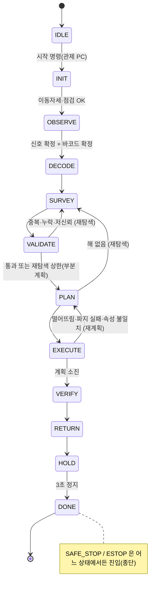

# 미션 FSM 설계 — 주사위 기억 로봇 (발제 v5)

> 판단 계층 설계 기준 문서. 코드: `ros2_ws/src/planning/nz2_mission`, `ros2_ws/src/perception/nz2_signal`, `ros2_ws/src/interfaces/nz2_interfaces`
> 작성 2026-11-02 · 기준 발제: 「주사위 기억 로봇」 v5 · `[가정]` = 실측·규정 확인 전 임시값, `[확인]` = 확인 필요

## 1. 미션 요약

1. 출발·관측 위치 (734, 950) mm에서 −X 방향의 신호등(바닥 설치, (80, 950))과 바코드((80, 650), 높이 450 mm)를 본다.
2. 신호등은 **경기 전부터 무한루프로** R·Y·G 12회 점멸을 반복한다. 12번째 뒤 3초 소등 다음부터가 한 프레임의 시작이다.
3. R·Y·G 횟수(각 1~6, 합 12)를 바코드 규칙(P2-01/03 오름차순, P2-02/04 내림차순, 동률 R→Y→G)으로 정렬해 L1·L2·L3에 배정한다.
4. 시작 박스 6곳의 퍽 12개(red·green, 원기둥 Ø30×60 / 직육면체 30×30×60)를 탐색해, 이동 전에 전체 할당을 확정한다.
   - R 그룹 = 빨강, G 그룹 = 초록, **Y 그룹 = 같은 모양(색 무관)**
5. 각 장소에 주사위 눈(점 간격 60 mm, 지도 +Y 고정, 회전 대체 불가)으로 놓고, 세 장소를 새로 촬영해 재검증한 뒤 출발 구역으로 복귀해 3초 정지한다.

## 2. 결정 기록 (2026-10 ~ 11)

| # | 결정 | 근거 |
|---|---|---|
| D1 | 신호는 무한루프. **경기 시작 전 관측 금지** (신호등 위치 검출 포함) | 운영 확인 |
| D2 | 12번째 뒤 소등은 **총 3초** (1+3 아님). 1주기 = 26초 | 운영 확인 |
| D3 | 신호는 완전한 프레임이 **K회(기본 3) 동일**해야 확정. 자리별 다수결 합성 금지 | 인식 정확도 미검증, 발제 "추정 금지" |
| D4 | 신호등 **위치만 YOLO**, 점등 상태는 ROI 밝기로 판정 | YOLO 프레임레이트 불규칙, YOLO는 '꺼짐'을 측정 못 함 |
| D5 | OBSERVE 동안 다른 GPU 작업 정지, 바코드(CPU)는 함께 | Orin Nano 자원 |
| D6 | ID 중복·누락, PLAN 해 없음 → **SAFE_STOP 아님, SURVEY 재탐색** | 팀 결정 |
| D7 | EXECUTE = **이동 / 줍기 / 싣기 / 놓기** 세분 | 팀 결정 |
| D8 | 팔 접기 대신 **이동자세**(팔이 차체 밖으로 안 나가고 무게중심 최저) — 모든 주행의 전제 조건 | 팀 결정 |
| D9 | 퍽 상태표(월드 모델)의 주인 = mission_fsm | 단일 진실 원천 |
| D10 | 관제 PC(RViz2 + 관제 프로그램): **시작·중단 명령 + 상태 수신만** | 운영 확인 |
| D11 | 소프트웨어 크래시 후 **자동 재시작은 허용**. 수십 초~수 분 동작 불능, 벽 붕괴 등은 Fail = 회차 끝. 시작 위치 복귀로 회차 종료, 재개 불가 | 운영 확인 |
| D12 | 장소별 접근 자세 고정 | 놓기 순서·간섭 |
| D13 | Pick & place 중 떨어뜨린 퍽은 **주워서 다시 올릴 수 있음** | 운영 확인 |
| D14 | 운영 모드 필요 | 팀 결정 |
| D15 | 상태 표시 = 관제 화면 + OpenCR 부저(짧은 소리) | 팀 결정 |
| D16 | 트레이(bin) 사용, **4칸** | 현 설계 |
| D17 | 경기 중 로봇 접근은 동작 불능·회차 종료 후 조정시간에만 → 시작은 관제 PC 명령. 대회 시 **전용 Wi-Fi 공유기** | 운영 확인 |

**폐기:** 운영팀 배포 매핑 DB·`mission_reader`·`MAPPING` 상태(이전 발제 기준)는 v5에서 쓰지 않는다.

## 3. 상위 상태

| 상태 | 하는 일 | 실패 시 |
|---|---|---|
| `IDLE` | 시작 명령 대기. **신호·바코드 카메라를 구독하지 않음** (D1을 코드 구조로 보장) | — |
| `INIT` | 이동자세 확인, 액션 서버 준비 확인 | `SAFE_STOP` (init_timeout) |
| `OBSERVE` | 바코드 + 신호 (§4) | 미등록 바코드·신호 미확정 → `SAFE_STOP` |
| `DECODE` | 검증 → 정렬 → L1~L3 배정 | 코드 버그 외 실패 없음 |
| `SURVEY` | 박스 순회 관측 (최근접 순서) | 박스 하나 실패 → 건너뛰고 계속 |
| `VALIDATE` | 누락·중복 ID·미확정 속성·저신뢰 검사 | → `SURVEY` 재탐색 (상한 후 부분 계획) |
| `PLAN` | 할당(§5) + 운반 계획 | 해 없음 → `SURVEY` 재탐색 / 상한 → 부분 할당 |
| `EXECUTE` | 단계 실행 (§6) | 회복형 (재시도·RECOVER·재계획) |
| `VERIFY` | 장소별 새 촬영 판정, 장소당 보정 1회 | 기록 후 계속 |
| `RETURN` → `HOLD` → `DONE` | 이동자세 → 출발 위치 → 3초 정지 | 재시도 5회 후 `SAFE_STOP` |
| `SAFE_STOP` | 동작 취소, 사유 기록, 재개 없음 | 종단 |
| `ESTOP` | 하드웨어 비상정지 | 종단 |

**SAFE_STOP으로 가는 경우 (전부):** 미등록 바코드, 바코드 판독 반복 실패, 신호 미확정(max_frames), OBSERVE 타임아웃, INIT 실패, 하드웨어 에러(`/state/hw_error`, 스킬 `HW_ERROR`), 복귀 실패, 관제 중단 명령.
그 밖의 실패는 **끝까지 가서 재검증·복귀**한다. 재검증 8점 + 복귀 10점 + 일부 배치 점수를 지키는 쪽이 유리하다.

## 4. OBSERVE — 신호·바코드

### 4.1 순서 (노출 문제 때문에 고정)

| 단계 | 노출 | 내용 | 종료 |
|---|---|---|---|
| `LOCATE` | 자동 | YOLO 신호등 bbox 15프레임 중앙값 → 램프 ROI 3개(세로 3등분, 중심부 60%). 동시에 **바코드 3회 연속 판독** | bbox 확정(실패 시 고정 ROI 폴백) |
| `LOCK` | → 수동 저노출 | 바코드 확정 대기 → `rgb_camera.exposure` 고정 → 0.5 s 안정 | — |
| `SYNC` | 저노출 | 2.5~3.5 s 소등(프레임 경계)까지 들어온 점멸 버림 | 첫 경계 |
| `CAPTURE` | 저노출 | 경계~경계 = 1프레임. 무효 사유가 있으면 프레임 버림 | — |
| `VOTE` | — | 같은 12자 문자열 K회 & 1위−2위 ≥ 2 → 확정 | max_frames 초과 → failed |

저노출에서는 하우징·종이 바코드가 검게 나와 YOLO·바코드가 실패한다. 그래서 **LOCATE와 바코드는 자동 노출에서 먼저 끝내고, 저노출 중에는 YOLO 재확인을 하지 않는다.**

### 4.2 점등 판정 (ROI 밝기)

- 밝기 = 각 ROI의 max(B,G,R) 평균. 픽셀은 3 px 간격으로 솎는다.
- 꺼짐 기준 = 램프별 최근 4 s 최솟값. 루프상 모든 램프는 2 s마다 최소 1 s 꺼진다.
- 1위 비율(밝기/기준) < 2.0 → `OFF`
- 1위/2위 < 2.0 → `AMBIG`. 번짐, 즉 켜진 램프 빛이 옆 ROI로 새는 경우를 거른다.
- 그 외 → 위치로 색 확정 (위 R, 가운데 Y, 아래 G).

### 4.3 시간 판정 (촬영 시각 `header.stamp`만 사용)

| 소등 길이 | 판정 |
|---|---|
| 0.4 s 미만 | 깜빡임 잡음 → 프레임 무효 |
| 0.4 ~ 1.5 s | 프레임 내부 간격 (공칭 1 s) |
| 1.5 ~ 2.5 s | 애매 → 프레임 무효 |
| 2.5 ~ 3.5 s | 프레임 경계 (공칭 3 s) |
| 3.5 s 초과 | 점등 누락·신호 정지 → 프레임 무효, 재동기화 |

- 켜짐은 0.6~1.4 s, 프레임 길이(첫 점등 시작 ~ 12번째 끝)는 23 ± 1 s여야 한다.
- 경계 시각 = 라벨이 바뀐 두 샘플의 중간이다. 샘플 공백이 0.3 s를 넘으면서 전환을 걸치면 프레임 무효로 처리한다.
- **함정:** 점등 하나를 놓치면 소등이 정확히 3 s(1+1+1)가 되어 경계와 구분할 수 없다. 다만 프레임이 k−1개와 12−k개로 쪼개져 점멸 수 ≠ 12 검사에 걸리고, 다음 진짜 경계에서 자동으로 재동기화된다(테스트 `test_missed_blink_invalidates_only_that_frame`).
- 필요 프레임레이트: 이론 하한 2.5 fps, 목표 10 fps 이상. 30 fps면 여유가 충분하다(ROI 밝기는 CPU로 처리).

### 4.4 소요 시간 (시뮬레이션 실측)

- 정상: 확정까지 **81~108 s (평균 95 s)**. 진입 시점에 따라 동기화 대기 0~26 s + 3프레임 78 s.
- 무효 프레임 1개당 +26 s. 점등 1회 누락 시 약 130 s.
- `max_frames: 8` (약 3.5분) 안에 확정하지 못하면 `SAFE_STOP`.

### 4.5 증거 로그

- 신호 결과 JSON에 `start_cmd_time`, `first_image_stamp`, 프레임별 `blink_times`·무효 사유를 모두 남긴다.
- `first_image_stamp > start_cmd_time`이면 경기 시작 전에 관측하지 않았다는 증거가 된다.
- 채점용 기록(색 순서 12개 + 각 횟수)은 `events.jsonl`의 `signal_confirmed`에 있다.

## 5. SURVEY ⇄ VALIDATE/PLAN

- **월드 모델:** 퍽마다 ID, 색, 모양, 신뢰도, 박스, 위치, 상태를 가진다.
  - 상태 종류: `IN_BOX / IN_GRIPPER / IN_TRAY / PLACED / DROPPED / LOST / UNUSABLE`
  - 인지 노드는 `/mission/puck_observations`로 **관측만** 보낸다.
- **VALIDATE 문제 종류:** missing(미관측), duplicate(같은 ID가 150 mm 이상 떨어진 곳에서 관측, 또는 목록 밖 ID), unknown_attr, low_conf(< 0.7).
- **재탐색:** 의심 퍽의 관측을 비우고, 해당 박스만 다시 본다. missing이 있으면 전체를 다시 본다. 같은 시점에서 반복 관측하면 같은 오판이 반복되므로, **회차마다 접근 각도·거리·그리퍼 근접 촬영을 바꾸는 것은 인지·팔 쪽(observe_box 스킬) 책임**이다.
- **할당:** Y 후보 조합을 전수 열거한다(최대 2 × C(12,6) = 1848가지). R·G는 남은 퍽 중 비용이 작은 것부터 고른다. Y가 정해지면 R·G 선택은 서로 독립이므로 이 방법이 최적이다.
- **해 없음:** 진단(색 부족, 모양별 수, 미확정 속성)과 의심 퍽을 로그로 남기고 재탐색한다. 퍽을 싣고 있으면 재탐색 대신 부분 계획으로 간다.
- **상한(`survey_max_rounds: 3`) 도달:** 부분 할당으로 간다. **완성 가능한 장소 수를 최대로**, 그다음 비용을 최소로 고른다.

## 6. EXECUTE — 이동 / 줍기 / 싣기 / 놓기

| 묶음 | 하위 상태 | 팔 스킬 / 액션 |
|---|---|---|
| 이동 | `TRAVEL_POSE` → `MOVE_TO_PICK` → `ALIGN_PICK` | travel_pose → Nav2 → align |
| 줍기 | `PICK` (근접 재판독 포함) | pick |
| 싣기 | `LOAD` (트레이 칸) | load |
| 이동 | `TRAVEL_POSE` → `MOVE_TO_PLACE` → `ALIGN_PLACE` | travel_pose → Nav2 → align |
| 놓기 | `UNLOAD` → `PLACE` → `CHECK_PLACE` | unload → place → check_place |
| 회수 | `RECOVER` → `LOAD` → 재계획 | recover_dropped |

**운반 계획 (`planner.py`)**
- 트레이 4칸이다. 한 trip은 주 목적지 L의 퍽을 가까운 박스부터 싣고, 남는 칸은 다른 L의 퍽으로 채운다.
- 박스·장소 방문 순서는 전수 순열로 최단을 고른다.
- 장소 안 놓기 순서는 접근 방향 기준 **먼 점 → 가까운 점**이다. trip이 나뉘어도 이 순서는 유지된다.
- 이동 중 그리퍼는 비운다.

**이동자세 가드**
- 모든 Nav2 이동 직전에 `travel_pose` 성공이 필요하다. 다른 팔 스킬이 실행되면 플래그가 해제된다.
- 플래그가 없으면 FSM이 `TRAVEL_POSE`를 자동으로 끼워 넣는다.

**실패 정책** (재시도: 이동 2회, 팔 2회. `DROPPED`·`MISMATCH`는 재시도 없이 바로 처리)

| 실패 | 처리 |
|---|---|
| 떨어뜨림 (`DROPPED`), LOAD·UNLOAD·PLACE 반복 실패 | `RECOVER` → 빈 칸에 `LOAD` → 재계획. RECOVER 실패 → `LOST` → 재계획 |
| PICK 반복 실패 | 그 퍽 `UNUSABLE` → 재계획 |
| 박스 이동·정렬 반복 실패 | 그 박스의 퍽 `UNUSABLE` → 재계획 |
| 장소 이동 반복 실패 | 재계획 (`max_plans`로 무한 반복 방지) |
| CHECK_PLACE 오차 > 10 mm | `FIX_PLACE` 1회 → 다시 확인 → 그래도 실패면 기록하고 진행 |
| PICK 근접 판독 ID·색·모양 불일치 | 월드 모델 갱신, LOAD 후 재계획 |
| 하드웨어 에러 | `SAFE_STOP` |

- 재계획은 이미 놓인 퍽을 고정 조건으로, 트레이·그리퍼의 퍽을 시작 재고로 쓴다.
- **퍽을 실은 채로 SURVEY에 가지 않는다.**

## 7. 전역 감시·재시작

- **무진행 감시:** 실행 중인 단계가 `no_progress_s`(30 s [확인]) 동안 진행 신호(액션 피드백·단계 전환)가 없으면 취소하고 실패로 처리한다. 심판의 동작 불능 기준보다 짧아야 한다.
- **체크포인트:** 상태 전이와 단계 완료마다 `~/nz2_runs/<run_id>/checkpoint.json`에 원자적으로 저장한다(임시 파일 → rename). `current.json`이 현재 회차를 가리킨다.
- **RESUME:** launch의 `respawn=True`로 노드가 다시 뜨면, 아래 재진입점으로 들어간다.

| 크래시 시점 | 재진입 |
|---|---|
| INIT·OBSERVE | 신호·바코드가 모두 확정돼 있으면 DECODE, 아니면 OBSERVE (다음 경계에서 재동기화) |
| SURVEY·VALIDATE | VALIDATE (저장된 월드 모델) |
| PLAN·EXECUTE | PLAN (트레이·그리퍼 재고 기준 재계획, 이동자세 가드가 첫 이동 전에 자동 삽입) |
| VERIFY | VERIFY 처음부터 |
| RETURN·HOLD | RETURN |
| DONE·SAFE_STOP·ESTOP | 아무것도 하지 않음 (회차 종료) |

- **한계:** 재진입 직후 그리퍼에 실제로 퍽이 있는지 물리적으로 확인하지 않는다. 팔 스킬 `travel_pose`는 퍽을 쥔 상태에서도 떨어뜨리지 않아야 한다. 추후 `check_inventory` 스킬 추가를 권장한다.
- **Jetson 자체 정지:** 소프트웨어로 복구할 수 없다. OpenCR 200 ms watchdog이 모터를 정지시킨다.

## 8. 운영 모드·관제

| 모드 | 용도 |
|---|---|
| `competition` | 실전. 시작·중단 외 명령 없음 |
| `rehearsal` | 실전과 동일 + 연습 기록 |
| `dry_signal` | 신호·바코드 주입(파라미터), OBSERVE 생략. 실제 하드웨어로 나머지 시험 |
| `dry_run` | 가짜 팔·Nav2·인지(`fake_skill_server`)로 전체 흐름 시험 (개발 PC) |

- 모드 변경은 `IDLE`에서만 `~/set_mode`로 할 수 있다. 시작 후에는 거부한다.
- 후속: `single_stage`(상태 하나만 실행), `manual`(관제 동작 명령)은 연습용으로 추가 예정이다 (§11).

**관제 PC 인터페이스**

| 이름 | 종류 | 방향 | 비고 |
|---|---|---|---|
| `/mission_fsm/start` | std_srvs/Trigger | PC → 로봇 | 멱등. 응답이 없으면 0.5 s 간격 최대 5회 재전송(관제 프로그램 책임) |
| `/mission_fsm/abort` | std_srvs/Trigger | PC → 로봇 | 회차 종료 → SAFE_STOP |
| `/mission_fsm/set_mode` | nz2_interfaces/SetMode | PC → 로봇 | IDLE에서만 |
| `/state/mission_phase` | String (transient local) | 로봇 → PC | 상위 상태 |
| `/state/mission_detail` | String JSON (best effort, 2 Hz) | 로봇 → PC | 하위 상태, 묶음(이동/줍기/싣기/놓기), 신호, 배정, 트레이, 퍽 표, 오류 |
| `/mission/heartbeat` | String JSON (best effort, 1 Hz) | 로봇 → PC | 링크 확인 |
| `/mission/log` | String JSON | 로봇 → PC | 이벤트 (회차 폴더 `events.jsonl`에도 저장) |
| `/mission/signal_status` | String JSON | 로봇 → PC | 신호 판독 진행(프레임·투표) |

- **Wi-Fi가 끊겨도 미션은 계속한다.** 로봇이 관제 PC에 의존하는 경로는 없다. 상태 토픽을 best effort로 보내므로 Wi-Fi가 나빠도 재전송이 쌓이지 않는다.
- **네트워크:** 대회용 전용 공유기를 쓴다. 모든 장비의 `ROS_DOMAIN_ID`를 같게 맞추고, 멀티캐스트가 막히면 DDS discovery server를 쓴다.

**부저 (`/ui/beep`, std_msgs/UInt8)** → 브리지 → OpenCR

| 값 | 패턴 | 의미 |
|---|---|---|
| 1 | 짧게 1번 | 상위 상태 전이 |
| 2 | 짧게 2번 | 신호 확정, 장소 1곳 완성, ARM, 회차 완료 |
| 3 | 길게 1번 | 회복형 오류 (재시도·재계획) |
| 4 | 짧게 3번 | SAFE_STOP / ESTOP |

OpenCR 펌웨어에서는 **비차단** 방식(`tone()` + 타이머로 끄기)으로 소리를 낸다. `delay()`를 쓰면 모터 제어 루프와 200 ms watchdog이 깨진다.

## 9. 노드 간 계약

**`arm_skill` (nz2_interfaces/ArmSkill) — 팔 계층이 구현할 것**

| skill | 입력 | 성공 조건·결과 |
|---|---|---|
| `travel_pose` | — | 팔 전체가 차체 400×400 투영 안 + 최저 자세. **퍽을 쥐고 있어도 떨어뜨리지 않음** |
| `align` | box_id 또는 location | 장소·박스 태그로 정밀 정렬 (Nav2 오차 보정) |
| `observe_box` | box_id | 관측자세로 퍽 관측 → 인지 노드가 `/mission/puck_observations` 발행. 재탐색 회차마다 시점 변경 |
| `pick` | puck_id, box_id | 파지 확인 + 근접 판독 `detected_puck_id/color/shape` |
| `load` / `unload` | puck_id, tray_slot | 칸 점유 확인. 실패 시 `DROPPED` |
| `place` | location, cell, target(map, z=0.07) | 격자점에 내려놓기 |
| `check_place` | location, cell | `place_error_mm` (이웃 밀림 포함) |
| `fix_location` | location, cell(선택) | 다시 집어 재배치 |
| `verify_location` | location, expected_pips | 새 촬영으로 판정. 불일치는 `success=false, error_code=MISMATCH`, 상세는 `result_json` |
| `recover_dropped` | puck_id | 주변 탐색 → 회수 → 그리퍼 파지 상태로 종료 |
| `hold` | — | 현재 자세 유지 |

- 오류 코드: `DROPPED`, `GRASP_FAIL`, `IK_FAIL`, `TIMEOUT`, `NOT_VISIBLE`, `MISMATCH`, `HW_ERROR`
- `HW_ERROR`가 오면 FSM은 즉시 SAFE_STOP으로 간다.
- 장시간 스킬은 **피드백을 주기적으로** 보낸다. 무진행 감시가 이 피드백을 진행 신호로 본다.

**주행:** Nav2 `navigate_to_pose`. 좌표는 경기장 mm → `arena_to_map` 변환 → map m.

**안전 입력:** `/state/estop` (Bool), `/state/hw_error` (String, 비어 있지 않으면 오류), `/ui/arm_button` (Bool, 선택)

## 10. 테스트

| 범위 | 파일 | 결과 |
|---|---|---|
| 신호 판정 (중간 진입 6종, 조합 25종, 불규칙 fps·드롭, 점등 누락, 번짐 약·강, 2 fps, 신호 정지) | `nz2_signal/test/test_signal_decoder.py` | 39 passed |
| 배정 50 case·동률, 주사위 좌표, 할당(무작위 40세계 브루트포스 대조), 부분 할당, 계획(용량·이동자세 가드·12칸 커버), 체크포인트, 재진입 | `nz2_mission/test/test_mission_core.py` | 190 passed |
| 실제 `mission_locations.yaml`로 50 case 계획 | `nz2_mission/test/test_config_locations.py` | 31 passed, 20 skipped(해당 퍽 구성에서 출제 불가 조합) |

- ROS 노드(`*_node.py`, `fake_skill_server.py`)는 작성 환경에 ROS 2가 없어 **문법·정적 분석(pyflakes)만 통과**했다. 첫 빌드 후 `dry_run`으로 실행 검증이 필요하다.
- 실물 리허설 순서: `dry_run`(개발 PC) → `dry_signal`(로봇, 신호 생략) → 신호 단독(실물 신호등 녹화 rosbag 재생) → `rehearsal`.

## 11. 후속 작업

1. 팔 스킬 서버 (`arm_skill`, §9 계약) — control/arm 담당
2. 퍽 인지 노드 → `/mission/puck_observations` (2색 HSV + depth 형상 + 퍽 태그 판독)
3. YOLO 신호등 **위치** 검출 노드 → `/perception/traffic_light/detections` (vision_msgs/Detection2DArray, class_id `traffic_light`)
4. OpenCR 부저 펌웨어 + `/ui/beep` 브리지, `/state/estop`·`/state/hw_error` 발행
5. 관제 프로그램 (시작 재전송, 상태 표, 링크 심박 표시, "시작 가능" 조건 표시)
6. `single_stage`, `manual` 연습 모드
7. `check_inventory` 스킬 (RESUME 직후 그리퍼·트레이 실물 확인)
8. `mission_locations.yaml` 실측값 반영 + `check_map.py` 검증, `arena_to_map` 보정

## 12. 확인 필요

- 심판의 '동작 불능' 판정 시간 → `no_progress_s`, 각 타임아웃
- 조정시간 ARM 버튼 허용 여부 → `require_arm_button`
- 실행 중 재계획, 재검증 후 보정(`verify_fix_attempts`), 바닥 퍽 회수 허용 범위
- 주사위 점수가 장소 단위인지 점 단위인지 (부분 계획 우선순위)
- 종료 400×400 판정에 팔·트레이 포함 여부
- 신호 노출값, 켜짐/꺼짐 밝기 비, 번짐 정도 (실물 신호등 앞에서 측정)
- realsense2_camera 노드 이름·노출 파라미터 이름 (4.57.7)
- 출발 자세에서 바코드(높이 450 mm)가 전면 카메라 시야에 들어오는지, `roi_xywh`·`fixed_roi_xywh` 값
- `python3-pyzbar`의 rosdep 키 존재 여부 (없으면 README 설치 절차에 apt 명령 추가)
- cuVSLAM 정지·재초기화 방법 (Isaac ROS 5.0 서비스 이름)
