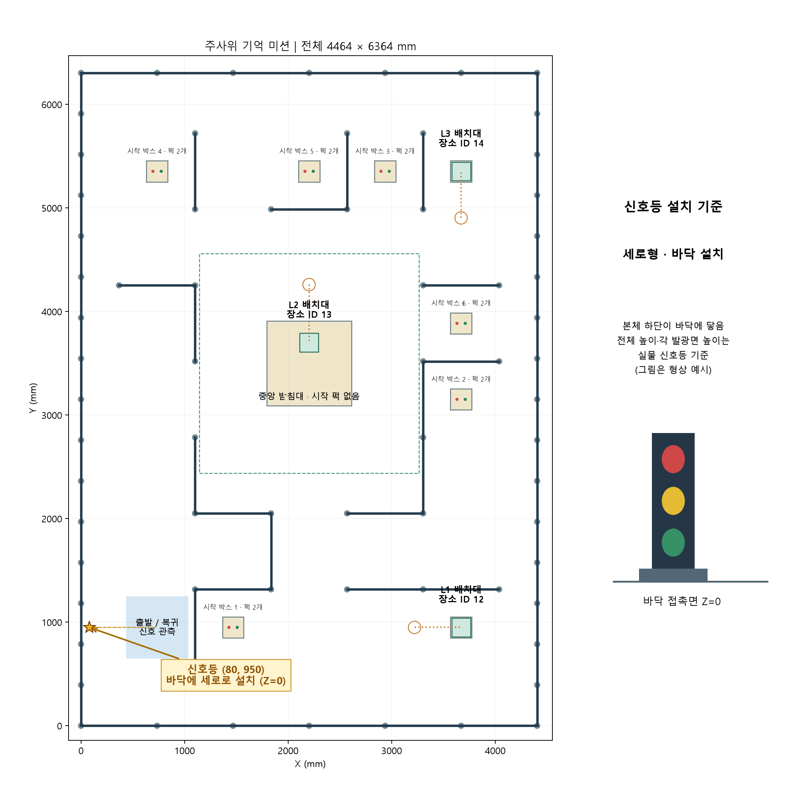
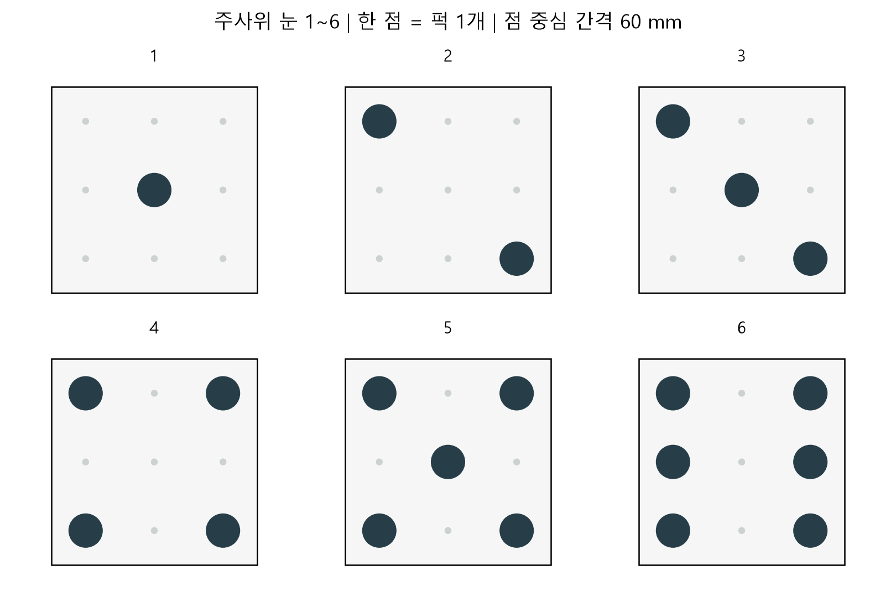

# NZ2 문제 패키지 1번

작성일 2026-11-17. 문제 ID는 `NZ2-Q1-review`다.
발제의 ‘6 주요 산출물 → ① 문제 패키지’에 대응한다.

## 작성 상태와 근거

공개 연습 문제 Q1의 신호·바코드·퍽 목록·초기 좌표를 사용한 검토용 문제다.
팀 레포의 실제 퍽 할당 함수에 이 목록을 넣어 정답과 좌표를 계산했다.
실물 12개 속성·설치 확인, 복귀 구역 실측, 다른 팀 검토가 남아 있으며 `review.json`에 상태를 기록한다.

경기 규칙은 `mission.pdf` v5의 1~8쪽을 따랐다. 제공 패키지 `mission.json`은 version 값이 v4이며, 여기서는 Q1 목록·좌표·눈 패턴을 가져왔다.
신호 시간·선반 높이·채점표는 v5와 대조했다. 출처와 SHA256은 `sources.json`에 기록했다.

| 파일 | 내용 |
| --- | --- |
| `problem.md` | 문제 조건·설치·운영·정답·100점 채점표 |
| `signals.json` | 운영자 제시 신호 12개·횟수·바코드·점멸 시간 |
| `placement.csv` | Q1 퍽 12개의 속성·박스·초기 좌표 |
| `arena.json` | 시작 박스·목적지·좌표계·눈 패턴·설치 기준 |
| `answers.json` | 유효 할당 예시와 목적지별 12개 목표 중심 좌표 |
| `validate.py` | 할당·배치·원본 일치·팀 계획 함수의 CPU 검증 |
| `validation.json`, `validation.md` | 실행한 검증 결과와 범위 |
| `review.json` | 실물 확인·다른 팀 검토·문제 버전 고정 상태 |
| `sources/` | 제공 패키지의 목록·배치·벽·기둥·그림·검증 함수 원본 |

## 경기 목표

출발 구역에서 신호등 점멸 12개를 관측해 순서와 색상별 횟수를 기억한다.
Code 128 바코드로 R/Y/G의 정렬 방향을 결정하고 L1~L3에 그룹을 배정한다.
퍽 12개를 중복·누락 없이 사용해 세 장소에 주사위 눈을 동시에 만들고, 새 카메라 관측으로 확인한 뒤 출발 구역으로 복귀한다.
시간 제한은 없다. 공식 경기 두 회차 중 높은 회차의 전체 점수를 적용한다.

## 제시 신호와 바코드

| 항목 | 이 문제의 값 |
| --- | --- |
| 순서 | `R G R R G R G G Y G Y G` |
| R 횟수 | 4 |
| Y 횟수 | 2 |
| G 횟수 | 6 |
| 바코드 | `P2-01` |
| 정렬 | 오름차순 |
| L1 → L2 → L3 | Y 2개 → R 4개 → G 6개 |

한 번의 점멸은 한 색 1초 켜짐과 1초 소등으로 구성한다.
12번째 발광이 끝난 뒤 3초 연속 소등되면 종료한다. 첫 점멸 시작을 0초로 둘 때 종료 확인은 26초다.
연속 같은 색도 사이 소등으로 별개 점멸로 구분한다. 소등은 횟수에 넣지 않는다.
로봇 준비 완료 후 운영자가 시작하며, 별도의 초록 출발 신호는 없다.
12개 기록·종료 확인·바코드 해독이 모두 완료되면 이동한다.

| 바코드 | L1~L3 정렬 방향 |
| --- | --- |
| P2-01, P2-03 | 횟수 오름차순 |
| P2-02, P2-04 | 횟수 내림차순 |

횟수 동률은 R → Y → G 순서를 유지한다.
R 그룹은 빨강으로, G 그룹은 초록으로 맞춘다. 두 그룹은 모양 혼합이 가능하다.
Y 그룹은 원기둥 또는 직육면체 한 모양으로 통일하고 색상 혼합을 허용한다.
각 색 횟수는 1~6, 합계는 12이며 실제 목록으로 전체 할당이 가능한 문제를 사용한다.

## 좌표계와 경기장 설치

단위는 mm다. 왼쪽 아래 기둥 중심이 X/Y 원점이며, 바닥이 Z=0이다. 지도 오른쪽이 +X, 위쪽이 +Y다.
경기장 전체 크기는 4464×6364이며 기존 벽·기둥 위치를 유지한다.
벽·기둥 기준은 `sources/walls.csv`, `sources/posts.csv`에 있다.



| 설치 대상 | 위치 또는 조건 |
| --- | --- |
| 신호등 본체 하단 | (80, 950, 0), 바닥에 세로로 설치, +X 방향 |
| 바코드 중심 | (80, 650, 450), +X 방향 |
| 신호 관측 로봇 중심 | (734, 950), -X 방향 |
| L1 / 장소 태그 12 | 격자 중심 (3670, 950), 퍽 바닥 Z=70 |
| L2 / 장소 태그 13 | 격자 중심 (2202, 3700), 퍽 바닥 Z=70 |
| L3 / 장소 태그 14 | 격자 중심 (3670, 5354), 퍽 바닥 Z=70 |
| L1·L3 받침 | 각각 205×205×70 박스 |
| 중앙 L2 받침 | 410×410×70 박스 4개로 구성한 820×820 받침대의 북쪽 |

신호등 전체 높이와 발광면 높이는 실제 장비를 측정한다.
복귀 구역은 현장에 표시된 출발 구역을 사용한다. 경계 꼭짓점은 실측 전이므로 `arena.json.return_zone_polygon_mm`을 비워뒀다.
차체 전체가 구역 안에 들어왔는지 판정할 수 있도록 운영자가 실제 경계를 확인하고 기록해야 한다.

문제지 v5의 장소 태그 설치 기준은 접근 방향 수직 면, 중심 Z=35다.
팀 `mission_markers.py`에는 11월 5일 사용자 지시를 근거로 상단 부착 설정이 남아 있다.
실제 설치 면과 태그→격자 변환을 확인해 적용할 기준을 검토 기록에 남겨야 한다.
퍽 태그 크기는 검은 마커 16mm, 장소 태그는 48mm라는 팀 등록 정보를 참고하되 실제 인쇄물과 대조한다.

## 초기 퍽 목록

모든 퍽은 세워 둔다. 원기둥은 Ø30×60, 직육면체는 30×30×60이다.
퍽 바닥 Z=70, 윗면 Z=130이다. 초기에는 시작 박스 6곳에 각 2개씩 놓고 L1~L3를 비운다.
각 박스의 L 슬롯은 중심 X−40, R 슬롯은 중심 X+40이며 Y는 박스 중심과 같다.
이번 Q1은 빨강 6개·초록 6개다. 다른 문제의 색상 비율은 실제 목록을 따른다.

| 시작 박스 | 중심 X,Y | L 슬롯 ID | R 슬롯 ID |
| --- | --- | --- | --- |
| S1 | 1468, 950 | 0 | 4 |
| S2 | 3670, 3152 | 8 | 5 |
| S3 | 2936, 5354 | 1 | 10 |
| S4 | 734, 5354 | 9 | 6 |
| S5 | 2202, 5354 | 2 | 7 |
| S6 | 3670, 3886 | 3 | 11 |

| ID | 색상 | 모양 | 시작 박스 | X | Y |
| --- | --- | --- | --- | --- | --- |
| 0 | R | 원기둥 | S1 | 1428 | 950 |
| 1 | R | 원기둥 | S3 | 2896 | 5354 |
| 2 | R | 원기둥 | S5 | 2162 | 5354 |
| 3 | R | 직육면체 | S6 | 3630 | 3886 |
| 4 | G | 원기둥 | S1 | 1508 | 950 |
| 5 | G | 원기둥 | S2 | 3710 | 3152 |
| 6 | G | 원기둥 | S4 | 774 | 5354 |
| 7 | G | 직육면체 | S5 | 2242 | 5354 |
| 8 | R | 직육면체 | S2 | 3630 | 3152 |
| 9 | R | 직육면체 | S4 | 694 | 5354 |
| 10 | G | 직육면체 | S3 | 2976 | 5354 |
| 11 | G | 직육면체 | S6 | 3710 | 3886 |

`placement.csv`의 id는 이번 문제의 물체 식별자다. 색상을 ID에 영구 고정하지 않는다.
이번 예제의 tag_id는 제공된 등록표 값을 그대로 사용하며 실물 태그 대응은 현장에서 대조한다.

## 할당 정답과 목적지 배치

| 장소 | 그룹·개수 | 정답 예시 ID | 조건 |
| --- | --- | --- | --- |
| L1 | Y·2 | 0, 1 | 원기둥 한 모양 |
| L2 | R·4 | 2, 3, 8, 9 | 모두 빨강 |
| L3 | G·6 | 4, 5, 6, 7, 10, 11 | 모두 초록 |

유효한 그룹별 ID 할당은 6개다. `validation.json`에 전부 기록한다.
같은 그룹 안에서 ID를 격자 점에 대응하는 순서는 자유이며, 유효한 다른 전체 할당도 인정한다.
다음 표는 팀 계획 함수가 선택한 한 가지 정답의 퍽 중심 좌표다. 모든 퍽 중심 Z는 100이다.

| 장소 | ID | 목표 X | 목표 Y |
| --- | --- | --- | --- |
| L1 | 0 | 3610 | 1010 |
| L1 | 1 | 3730 | 890 |
| L2 | 2 | 2142 | 3760 |
| L2 | 3 | 2262 | 3760 |
| L2 | 8 | 2142 | 3640 |
| L2 | 9 | 2262 | 3640 |
| L3 | 4 | 3610 | 5414 |
| L3 | 5 | 3610 | 5354 |
| L3 | 6 | 3610 | 5294 |
| L3 | 7 | 3730 | 5414 |
| L3 | 10 | 3730 | 5354 |
| L3 | 11 | 3730 | 5294 |

각 장소 중심 기준 X,Y 각각 −60, 0, +60의 3×3 격자를 사용한다. 배치 영역은 180×180이다.
2·3의 대각선은 좌상단에서 우하단으로 향하고, 6은 좌우 두 열이다. 모든 장소에서 지도 축 방향을 유지한다.
퍽 중심 오차가 각 목표에서 10mm 이내이며 2초간 안정된 상태여야 한다.
빈 격자에 추가 퍽이 있으면 해당 장소의 눈 배치는 실패다.
퍽 쌓기와 바닥 임시 보관을 금지하며, 전체 12개를 동시에 세 장소에 놓는다.



## 100점 채점표

| 항목 | 배점 | 판정 |
| --- | --- | --- |
| 신호 순서 기억 | 12 | 12개 시점별 색상 일치 각 1점 |
| 색상별 횟수 | 9 | R·Y·G 정답 횟수 각 3점 |
| 바코드 해석 | 4 | 실물 코드와 정렬 방향 모두 일치 |
| 장소 그룹 배정 | 9 | L1~L3 정답 그룹 각 3점 |
| 색상·모양 선택 | 18 | 장소별 개수와 R/G 색상 또는 Y 모양 모두 충족 각 6점 |
| 주사위 눈 배치 | 30 | 장소별 정답 눈·위치·안정 조건 모두 충족 각 10점 |
| 이동 후 검증 | 8 | 새 관측 기반 장소별 ID·위치 기록 각 2점, 전체 중복·누락 판정 2점 |
| 복귀 | 10 | 차체 전체가 출발 구역 안에서 3초 정지 |
| 합계 | 100 | 회차별 원점수 |

공식 두 회차는 각각 평가하고 높은 회차의 전체 점수를 적용한다. 서로 다른 회차의 항목 점수를 합산하지 않는다.
신호·횟수·바코드는 실제 관측 기록으로 평가하며, 재검증은 이동 후 새 관측을 사용한다.
임의 감점과 시간 가산점은 없다.
통합 경기 항목 25점은 원점수×0.20에 자율 완주 5점을 더한다.
자율 완주는 신호·정렬·세 장소 정답·재검증·복귀가 모두 성공한 경우 인정한다.

## 초기화와 경기 운영

1. 벽·기둥·박스 위치를 원본 배치도와 대조하고 출발·복귀 구역 경계를 표시한다.
2. 실물 퍽 12개의 ID·색상·모양을 등록표와 대조한다. 이 예제와 다르면 입력 목록을 갱신하고 전체 할당을 다시 검증한다.
3. `placement.csv`대로 시작 박스 6곳에 두 개씩 세워 놓고 L1~L3를 비운다.
4. 신호등·바코드·장소 태그 위치와 카메라 시야를 확인하고 로봇을 출발 관측 자세에 둔다.
5. 이전 회차 신호·할당·재검증 결과를 초기화하고 이번 회차 영상·로그 기록을 시작한다.
6. 로봇 준비 확인 후 운영자가 `signals.json`의 순서로 점멸시킨다.
7. 로봇은 12회 기록·종료·바코드 확인 후 전체 할당, 탐색·주행·집기·배치를 수행한다.
8. 새 관측으로 장소별 ID·위치·중복·누락을 확인하고 출발 구역으로 복귀해 3초 정지한다.
9. 회차별 원점수·완주 여부·실패 지점과 원본 영상·로그를 저장한다. 다음 회차는 같은 문제 조건으로 초기화한다.

12회 미만·초과, 불명 색상, 미등록 바코드, ID 중복·누락은 오류를 기록하고 안전 정지한다.
팀 오류로 신호를 다시 보여주거나 결과를 수동 수정해 같은 회차를 이어가지 않는다.
운영 장비 오류가 확인되면 무효 처리 후 같은 조건으로 재시도한다.
비상정지·포기·고장 시점까지의 유효 점수는 기록한다.

## 검증 재실행

팀 레포 루트에서 다음 명령을 실행한다. Python 표준 라이브러리와 저장소의 CPU 계획 함수만 사용한다.

```bash
python3 problem/validate.py --output problem/validation.json
```

입력 변경 후에도 `logical_pass`가 true인지 확인한다.
`submission_ready`는 실물 확인·다른 팀 검토·문제 버전 고정 상태를 함께 기록한다.
현재는 실물 확인과 다른 팀 검토가 남아 있다.
제공 목록의 속성을 바꿔 새 문제를 출제할 때는 이 Q1 패키지를 복사해 새 문제 ID와 출처 등록표·정답을 함께 갱신한다.

## 제출 전 남은 확인

- 실제 12개 퍽 속성·태그 ID와 초기 배치 확인
- 출발·복귀 구역 경계 좌표 기록
- 장소 태그 설치 면·높이·태그에서 격자로의 변환 확인
- 다른 팀의 검토자·날짜·의견·수정 후 확인 기록
- 최종 문제 커밋에 `project2-problem-submit` 태그 지정

다른 팀 검토는 `review.json.other_team_review`에 기록한다.
물리 시험과 공식 경기 결과는 산출물 2·3의 시험 기록에서 다룬다.
