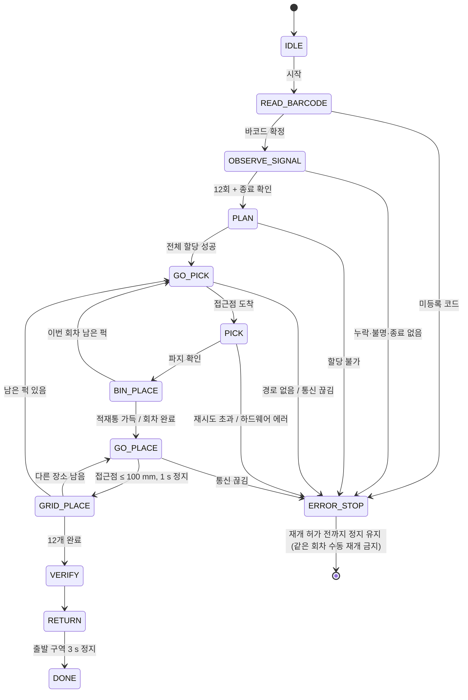

# NZ2 시스템 설계 — 주사위 기억 로봇 (architecture.md)

- 팀: NZ2 (Nine Zero Noize Zero) / 저장소: `KANT-PA1-Project/lv2-nz2-project2`
- 기준 문서: mission.pdf v5 (2026-11-04) / 작성: 2026-11-17
- **시험 환경: 로봇 실물 시험 없음.** 주행·팔·통합은 시뮬레이션(Gazebo·Isaac Sim). 신호·바코드는 시뮬레이션 + 로봇에 달지 않은 실물 D435 카메라·실물 신호등 사진/영상 시험이 있다.

상태 표기: **모의 통과** = 시뮬레이션에서 기준 충족 / **모의 부분** = 시뮬레이션에서 일부만 충족 / **미검증** = 코드·설계는 있으나 시험 기록 없음 / **미구현** = 설계만 있음

---

## 1. 입력과 목표 결과

| 구분 | 내용 |
|---|---|
| 입력 | 신호등 12회 점멸(R/Y/G, 1 s 켜짐 + 1 s 소등, 끝 3 s 소등), 바코드 Code128 1종(P2-01~04), 퍽 AprilTag 36h11 ID 0~11(16 mm), 장소 태그 ID 12~14(48 mm) |
| 출력 | L1~L3 주사위 눈 배치(중심 오차 ≤ 10 mm, 2 s 안정), `signal.json`, `allocation.json`, 재검증 로그, 출발 구역 복귀 후 3 s 정지 |
| 좌표 원점 | 왼쪽 아래 외벽 기둥 중심, +X 오른쪽, +Y 위, 바닥 Z = 0, 단위 mm (ROS 2 는 m) |
| 고정 위치 | 출발·관측 (734, 950), 신호등 (80, 950, 0), 바코드 (80, 650, 450) |
| 장소 | L1 (3670, 950) / L2 (2202, 3700) / L3 (3670, 5354) — **셋 다 205×205×70 mm 박스**, 로봇 접근 가능 |
| 시작 박스 | (1468, 950), (3670, 3152), (2936, 5354), (734, 5354), (2202, 5354), (3670, 3886) — 박스마다 퍽 2개, X ± 40 mm |
| 퍽 | 원통 Ø30×60 mm / 직육면체 30×30×60 mm, 빨강·초록, 바닥 Z = 70, 윗면 Z = 130 mm |
| 퍽 등록표 (팀 확정) | ID 0~5 빨강, 6~11 초록. 색마다 0~2·6~8 원통, 3~5·9~11 직육면체. 시작 박스 k 에 ID 2k(X−40)·2k+1(X+40) |

## 2. 하드웨어 (최종 URDF `real_final_plz_no_more_edit_v99_nz2fix.urdf` 기준)

| 부품 | 사양 | 연결 |
|---|---|---|
| 상위 컴퓨터 | Jetson Orin Nano 8GB Super, L4T R39.2.1, Ubuntu 24.04.5, ROS 2 Lyrical | — |
| 개발 PC | Legion Pro 5, Gazebo(주행), Isaac Sim / Isaac Lab 6.1(팔) | Wi-Fi, `ROS_DOMAIN_ID=78` |
| 구동 | 스월브 4모듈, XM430-W210 ×8 (구동 ID 1-4, 조향 ID 5-8), 구동 증속 4:1, 바퀴 Ø66 mm | OpenCR #1 (USB) |
| 팔 | OpenMANIPULATOR-X 개조, XM430-W350 (관절 ID 11-14, 그리퍼 15, 손목 롤 16), 차체 정면(12시) 장착 | OpenCR #2 (USB) |
| 카메라 | 상단 D435 (뒤쪽 2020 마스트, 하향 35°), 손목 D435, 해상도 640×480 고정 | USB 3 |
| 라이다 | LDS-03 ×4, 차체 모서리 | USB |
| 적재통 | 컵형, 3시·9시 방향 [최신 기록: 8칸, 확인 필요] | — |
| 비상정지 | E-stop → 12 V 모터 전원 릴레이 차단 (Jetson 전원 유지) | 하드웨어 |

| 기구 수치 | 값 | 근거 |
|---|---|---|
| 스월브 외곽 폭 | 0.436 m (진행 수직 폭 0.430 m) | 실측 |
| 제자리 회전 지름 | 0.504 m | URDF |
| 최대 속도 | 0.898 m/s (65 rpm × 4 × π × 0.066 m ÷ 60) | 계산 |
| 미로 최소 통로 | 550 mm → 한쪽 여유 약 60 mm | 경기장 |

## 3. ROS 2 노드·토픽

> 노드 = 하나의 실행 프로그램. 토픽 = 노드 사이 데이터 통로(발행/구독). 액션 = 오래 걸리는 작업 요청(피드백·취소 가능). QoS = 전달 신뢰성·보관 정책.

### 3.1 패키지

| 패키지 | 내용 | 언어 |
|---|---|---|
| `nz2_interfaces` | 커스텀 msg 12 · srv 5 · action 1 (Puck, PuckMap, SafetyState, SignalSequence 등) | — |
| `perception` | YOLO 퍽 검출, AprilTag, 퍽 레지스트리 (PR #26) | C++/Python |
| `planning` | mission_fsm, planning_master, 할당 | Python |
| `control` | control_master, arm_bridge, swerve bridge | C++ |
| `nz2_swerve_nav` | Nav2 설정·launch, cmd_frame_adapter, 시험 도구 | Python/YAML |
| `r12_swerve_control` (팀 `r12/`) | 스월브 IK·조향 최적화·OpenCR 브리지 | C++ |
| `nz2_arm_task` | 팔 IK 상태기계 (PICK_TO_BIN / BIN_TO_PLACE) | Python |
| `nz2_bringup` | 전체 실행 launch | — |

### 3.2 노드 표

| 계층 | 노드 | 입력(구독) | 출력(발행) | 상태 |
|---|---|---|---|---|
| 인식 | `yolo_detector` (TensorRT, 9클래스) | `/camera_arm/color/image_raw` | `/perception/detections` | 미검증 (PR #26) |
| 인식 | `tag_reader` (36h11) | 이미지·`camera_info` | `/nz2/tags` | 미검증 |
| 인식 | `puck_registry` | detections · tags · depth · tf | `/perception/puck_tracks` (frame `map`) | 모의 부분 (§8 T-PER-01) |
| 인식 | `signal_decoder_node` (`nz2_signal`) + `traffic_light_filter_node` | 마스트/손목 카메라 | 신호 기록 (12회 순서·횟수·종료) | 모의 통과 (Isaac 전체 로봇 B16), 실물 사진 43/46 |
| 인식 | `barcode_reader_node` (zxing-cpp, 라벨 크롭) | 마스트/손목 카메라 | `Barcode`·`BarcodeArray` | 모의 부분 (Isaac 48조건 중 3), 실물 D435 720p 영상 확정 |
| 판단 | `mission_fsm_node` (`nz2_mission`) | 위 전부 | 주행·팔 액션 요청, 회차별 `events.jsonl`·체크포인트 | 단위 시험 통과, 통합 실행 기록 없음 |
| 판단 | `nz2_mission.core` (mission_spec · allocator · dice_layout · planner) | signal · barcode · 퍽 등록표 | 장소 배정·전체 할당·놓기 순서 | 단위 시험 221 통과, 할당 계산 (`tools/build_results.py`) |
| 주행 | `map_server` · `amcl`(Omni) | `/map`, `/scan` | `map→odom` tf | 모의 통과 |
| 주행 | `planner_server`(NavFn) · `controller_server`(MPPI Omni) · `bt_navigator` | 목표 pose | `/cmd_vel` | 모의 통과 |
| 주행 | `velocity_smoother` | `/cmd_vel` | `/cmd_vel_smoothed` | 모의 통과 |
| 주행 | `cmd_frame_adapter` | 속도 명령 · `/joint_states` | r12 명령 · `/cmd_frame_adapter/gate` | 모의 통과 |
| 주행 | `swerve_controller_node` (r12) | 차체 속도 | 모듈 조향각·바퀴 속도, `/swerve/footprint` | 모의 통과 |
| 주행 | `r12_cmd_to_gz` (시뮬 전용) | 모듈 명령 | Gazebo 관절 | **타임아웃 없음 (Issue #5)** |
| 주행 | `scan_merger` + `coin_d4_driver` ×4 | 라이다 4개 | `/scan` | 시뮬은 Gazebo 라이다 |
| 제어 | `control_master` | 모든 명령 | 감시된 명령 (끊김 0.15 s → 정지) | 미검증 |
| 팔 | `arm_task_server` | 퍽 pose | 관절 궤적 → `arm_bridge` → OpenCR #2 | 집기 모의 통과 (Isaac) |
| 판단 | `verifier` | 재관측 `/nz2/tags` · puck_tracks | `/mission/verification` | 미구현 |

### 3.3 주요 토픽

| 토픽 | 타입 | QoS | 비고 |
|---|---|---|---|
| `/cmd_vel` | `geometry_msgs/TwistStamped` | Reliable | 스월브는 linear.x · linear.y · angular.z 모두 사용 |
| `/scan` | `sensor_msgs/LaserScan` | Best Effort | 4개 병합, 10 Hz, max_scan_age 0.30 s |
| `/joint_states` (실물 `/r12/joint_states`) | `sensor_msgs/JointState` | Reliable | 정렬 게이트가 측정 조향각 사용 |
| `/swerve/footprint` | `geometry_msgs/PolygonStamped` | Reliable | 지역 코스트맵 footprint |
| `/perception/puck_tracks` | `nz2_interfaces/PuckMap` | Reliable | frame `map` |
| `/estop` | `std_msgs/Bool` | Reliable + TransientLocal | 비상정지 |
| 영상 | `sensor_msgs/Image` 640×480 | Best Effort, depth 1 | depth 16UC1 = mm |

## 4. 좌표계 (tf)

> tf = 좌표계 사이 위치·회전 관계를 실시간으로 알려주는 ROS 2 기능. 자식 프레임의 부모는 하나뿐이다.

```
map ──(AMCL)──> odom ──(swerve_controller_node, wheel odom)──> base_footprint ─> base_link
                                                                  ├─> lidar_* (4, scan_joint)
                                                                  ├─> top_camera_link ─> *_optical_frame
                                                                  └─> arm_link1 ─> ... ─> arm_link5 ─> gripper / wrist_camera
```

| 항목 | 값 |
|---|---|
| map 원점 | 경기장 원점과 일치 (`shift_map_origin.py` 로 지도 origin 이동). 대회 mm ÷ 1000 = ROS m |
| 초기 자세 | 시뮬 (0.734, 0.950, 0) / 실전 (0.734, 0.950, π) — 신호등(−X) 관측 |
| `map→odom` 발행자 | AMCL 단독. 지도 작성(Cartographer·slam_toolbox)과 AMCL 동시 실행 금지 |
| 카메라 optical | z 앞, x 오른쪽, y 아래 (로봇 축과 다름 → tf 변환 필수) |
| 손목 카메라 | 움직이는 프레임 → lookupTransform 에 영상 stamp 사용 |
| 집기 높이 | 세운 퍽 윗부분 15 mm 이상 쥠 (손가락 패드 15×37.5 mm) |
| 놓기 높이 | 퍽 바닥 Z = 70 mm (쌓기·바닥 임시 보관 금지) |

### 4.1 주사위 격자 (mission.pdf v5 p.4, 장소 중심 기준 dx, dy mm, 지도 +Y 위, 회전 대체 불가)

| 눈 | 칸 |
|---|---|
| 1 | (0, 0) |
| 2 | (−60, +60), (+60, −60) — 왼쪽 위 ↘ 오른쪽 아래 |
| 3 | 2 + (0, 0) |
| 4 | (±60, ±60) 네 모서리 |
| 5 | 4 + (0, 0) |
| 6 | x = −60, +60 두 열 × y = +60, 0, −60 |

빈 칸에 퍽이 있으면 그 장소 실패. 지도 좌표 → 로봇 yaw 로 팔 좌표 변환. 놓는 순서는 먼 칸 → 가까운 칸, 손가락은 이웃 퍽이 없는 축으로 벌림.

## 5. 임무 순서와 단계별 완료 조건

| 단계 | 시작 조건 | 완료 조건 | 실패 시 | 구현 상태 |
|---|---|---|---|---|
| ① 바코드 | 출발 (734, 950) 정지 | 5 s 창 안에서 같은 코드 3회 → 확정 | 미등록 → 무시·확정 안 함 → ERROR_STOP | 모의 통과 (B16), 실물 영상 부분 |
| ② 신호 관측 | 바코드 확정 → 관측 자세 이동 → 정지 1 s 후 READY | 12회 + 종료 3 s 소등, R/Y/G 각 1~6 | UNKNOWN 색·프레임 간격 > 0.25 s·합계 ≠ 12 → ERROR_STOP (추측 금지) | 모의 통과 (B16) |
| ③ 그룹 배정 | 신호·바코드 확정 | 오름/내림 안정 정렬, 동률 R→Y→G | 잘못된 신호 문자열 → SpecError | 단위 시험 통과 |
| ④ 전체 할당 | 퍽 12개 ID·색·모양 등록 | Y 모양 조합 전수 → 남은 R/G 거리 비용 최소, 중복·누락 0 | 불가 → 진단 후 재탐색(최대 3회) → 부분 계획 | 단위 시험 통과 |
| ⑤ 수집 | 할당 완료 | 시작 박스 접근 → 퍽 pick → 적재통 place (퍽을 든 채 주행 안 함) | 재관측 실패 → 재시도 후 ERROR_STOP | 주행·pick 모의 통과, 적재통 place 미검증 |
| ⑥ 배치 | 장소 접근점 도착 (≤ 100 mm, 1 s 정지) | 적재통 pick → 격자 place, 2 s 안정 | | 주행 모의 통과, place 미검증 |
| ⑦ 재검증 | 모든 배치 완료 | 새 영상으로 장소별 ID·위치 기록, 전체 중복·누락 판정 | 가림 → "미확인" 기록 | 미구현 |
| ⑧ 복귀 | 재검증 완료 | 출발 구역 안 3 s 정지 | | 모의 통과 (START 목표) |

팔 동작 세부 (pick, Isaac 026 채택값): LOOK → TO_VIA(+60 mm) → **정지 게이트**(추종 오차 < 0.02 rad, 관절속도 < 0.05 rad/s 를 0.2 s, 최대 1 s) → DESCEND(0.10 m/s) → 정지 게이트 → APPROACH(0.05 m/s) → GRIP → LIFT(60 mm). place: TO_VIA → DESCEND(바닥 + 3 mm, 0.03 m/s) → RELEASE(열림 44 mm, 0.5 s) → RETREAT(+60 mm) → VERIFY 2 s.

## 6. 상태 전이도



## 7. 안전 정지·오류 처리

| 오류 | 감지 | 동작 | 시험 | 결과 |
|---|---|---|---|---|
| 신호 누락·불명·종료 없음 | UNKNOWN 프레임, 프레임 간격 > 0.25 s, 합계 ≠ 12, 종료 소등 < 3 s | ERROR_STOP | T-SW-SIG-01, T-SIG-04 | 모의 통과 (단위 시험) |
| 미등록 바코드 | 문자열 ∉ {P2-01..04} | 확정 안 함 → ERROR_STOP | T-SW-MIS-01 | 모의 통과 (단위 시험) |
| 할당 불가 | 탐색 실패 | 진단 → 재탐색 → 부분 계획 | T-SW-MIS-01 | 모의 통과 (단위 시험) |
| 주행 명령 끊김 | control_master 0.15 s, OpenCR 타임아웃 | 바퀴·팔 정지 | T-SAFE-01 | **시뮬 실패**: `r12_cmd_to_gz` 종료 시 바퀴 마지막 속도 유지 (Issue #5) |
| 경로 없음 | Nav2 계획 실패 | 로봇 정지 | T-NAV-02 | 모의 확인 (정지 유지) |
| 비상정지 | 릴레이 개방 | 모터 전원 차단 | — | 실물 없음, 미검증 |
| 다이나믹셀 하드웨어 에러 | Hardware Error Status | 토크 OFF | — | 미검증 |

## 8. 시험 요약 (상세: `results/test-results.csv`)

| 영역 | 결과 (전부 모의) |
|---|---|
| 주행 (Gazebo + Nav2) | 최종 v11: facing 5/5, basic 4/4, 정지 오차 최대 74 mm (기준 100 mm), 벽 최소 여유 45.6 mm |
| 집기 (Isaac Lab, IK 상태기계) | 256 에피소드 95.7 % (026) |
| 퍽 위치 인식 (합성 영상) | 0.45 m 거리 xy 오차 ≤ 1.7 mm (비교 인식기), 팀 깊이 대체 경로 z +14 mm 편향 |
| 신호·바코드 인식 (Isaac) | 전체 로봇 B16: 바코드 P2-02 확정, 12회 순서 일치, 810/810 프레임 정답. 카메라 고정 8/8 |
| 신호·바코드 인식 (실물 카메라, 로봇 미탑재) | 신호등 사진 43/46 (개선 전 35/46), 바코드 720p 영상 356/663 프레임 |
| 판단 로직 (pytest) | nz2_mission 221 통과·20 건너뜀, nz2_signal 39 통과 |
| 미시험 | 태그 ID 인식, 적재통·격자 place, 재검증, 비상정지, 신호→복귀 전체 통합 |

## 9. 알려진 한계

- 실물 시험이 없다. 시뮬 결과를 실물 성공으로 보지 않는다.
- `signal.json` 은 Isaac 시뮬 관측(B16)이다. 실물 D435 노출·화이트밸런스로는 검증되지 않았다.
- 640×480 에서 바코드는 라벨 폭 ≥ 120 px (약 0.3 m 이내)일 때만 안정적으로 읽힌다.
- 신호 판정은 카메라 자세 오차 1~3 cm 에서 급경사 시점이 실패한다.
- 목표 앞 미세 정렬에서 조향만 반복해 시간이 걸린다 (안전 문제 아님).
- 손목 D435 는 약 0.20~0.25 m 안에서 깊이가 0 → 재관측은 0.30 m 이상 거리에서 한다.
- 잔차 RL 은 IK 대비 개선 없음 (잔차 출력 ≈ 0), 대회 버전은 IK 상태기계.
