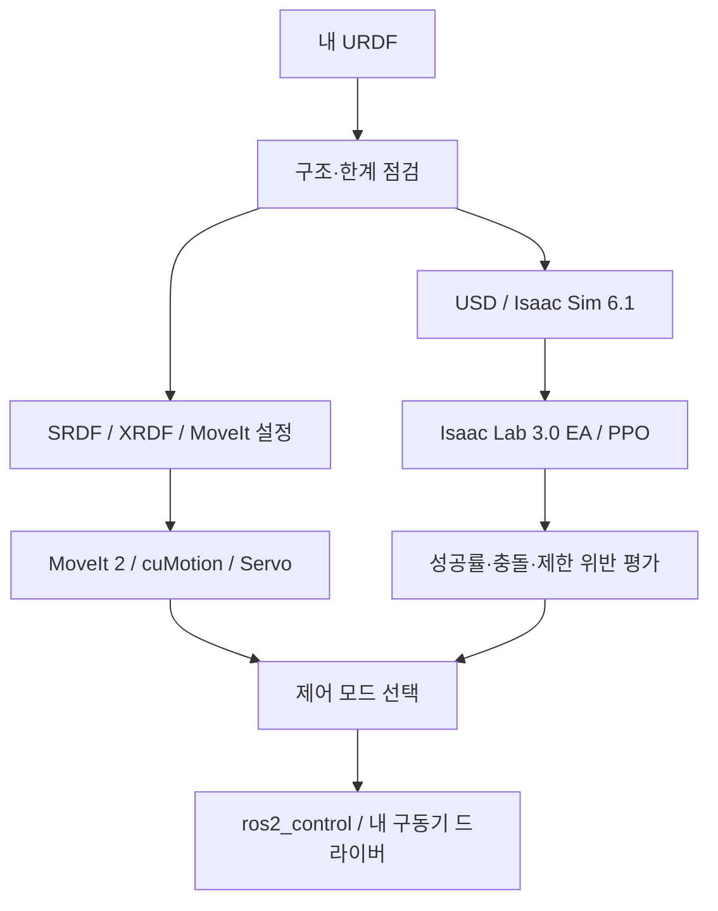

# 직접 만든 로봇팔 제어와 정책학습

**Ubuntu 24.04 · ROS 2 Lyrical · Isaac ROS 5.0 · Isaac Sim 6.1 · Isaac Lab 3.0 EA**

내 URDF의 구조와 한계를 확인하고, USD 변환·MoveIt 2/cuMotion 경로계획·PPO 학습을 순서대로 진행합니다. 예제 3축 팔은 설치 점검용입니다. 자기 로봇으로 바꿀 항목은 별도 표로 정리했습니다.

[강의 Google Slides](https://docs.google.com/presentation/d/19Cm20IOrMMtM20Oa2HlBS0TIKsHxAHagd9Dd_-BGxNg/edit) · [강의자료 폴더](https://drive.google.com/drive/folders/1iDHZ3i8422OahM8dH_xqxajuTXj3m1cp)

교안은 64장입니다. 공식 이미지 14개·내장 영상 6개·편집 가능한 흐름도와 표를 포함합니다. Google 자료와 영상에는 소유자가 지정한 Drive 접근 권한이 적용됩니다.

## 제공 R12 로봇으로 실행

팔 5축 고정 베이스 학습, 제공 USD 재사용, ROS 브리지 및 가상 궤적 제어는 [R12 실행 가이드](docs/R12.md)를 따릅니다. 원본 대용량 자산은 Git에 포함하지 않으며 ZIP을 `assets/vendor/`에 압축 해제합니다.

## 먼저 읽을 문서

| 순서 | 문서 | 완료할 일 |
|---|---|---|
| 1 | [설치 가이드](docs/INSTALL.md) | 버전·GPU·Docker·Lab 환경 준비 |
| 2 | [실습 순서](docs/PRACTICE_GUIDE.md) | URDF 점검 → USD → 내 팔 학습·재생 |
| 3 | [코드 작성과 수정](docs/CODE_GUIDE.md) | 파일 역할·관측·행동·보상·성공 조건 |
| 4 | [MoveIt 2와 cuMotion](docs/MOVEIT_CUMOTION.md) | 내 로봇 계획 그룹·충돌 모델·컨트롤러 |
| 5 | [Lyrical과 Sim 연결](docs/LYRICAL_SIM_BRIDGE.md) | 배포판 분리·토픽·TF·명령 경로 검증 |
| 6 | [모방학습과 VLA 확장](docs/LEARNING.md) | 시연 수집·Mimic·GR00T의 차이 |
| 7 | [검증 기록](reports/VALIDATION.md) | 확인한 내용과 아직 실행하지 않은 내용 |



## CPU 예제부터 실행

아래는 Ubuntu Bash 명령입니다. GPU나 ROS 없이 URDF 점검·보상 계산부터 확인합니다.

```bash
git clone https://github.com/SeongminJaden/manipulator-isaac61-lyrical-practice.git
cd manipulator-isaac61-lyrical-practice
python3 -m venv .venv-cpu
source .venv-cpu/bin/activate
python -m pip install -e .
python scripts/inspect_urdf.py assets/demo_arm.urdf --output reports/local/urdf.json
python -m arm_practice.preflight assets/demo_arm.urdf configs/demo_robot.json --output reports/local/preflight.json
python scripts/action_reward_demo.py
python -m unittest discover -s tests -v
```

성공 기준: 관절 3개와 `tool0`가 출력되고 테스트가 통과합니다. 이는 GPU 학습·실물 동작 성공을 뜻하지 않습니다.

## 버전의 의미

Sim 6.1을 유지하므로 Lab은 **`v3.0.0-EA`**에 고정합니다. Lab 정식 `v3.0.0`은 Sim 6.2 대상입니다. EA는 LTS가 아닙니다. ROS 2 Lyrical LTS와 Ubuntu 24.04 LTS를 사용하더라도 전체 NVIDIA·학습 스택이 LTS로 바뀌지는 않습니다.

Sim 6.1의 Lyrical 네이티브 브리지 로드는 실험적 경로입니다. 설치 가능성과 실물 제어 검증은 구분합니다. 현재 저장소의 검증 범위는 [검증 기록](reports/VALIDATION.md)에 적었습니다.

## 폴더

```text
assets/demo_arm.urdf       설치 확인용 3축 로봇
configs/demo_robot.json   관절·TCP·한계·작업 공간
scripts/                 설치·변환·점검 실행 파일
src/arm_practice/         CPU 함수 + Lab 사용자 태스크
tests/                   CPU 검증
docs/                    설치·실습·함수 작성·공식 자료
reports/                 검증 범위
```
