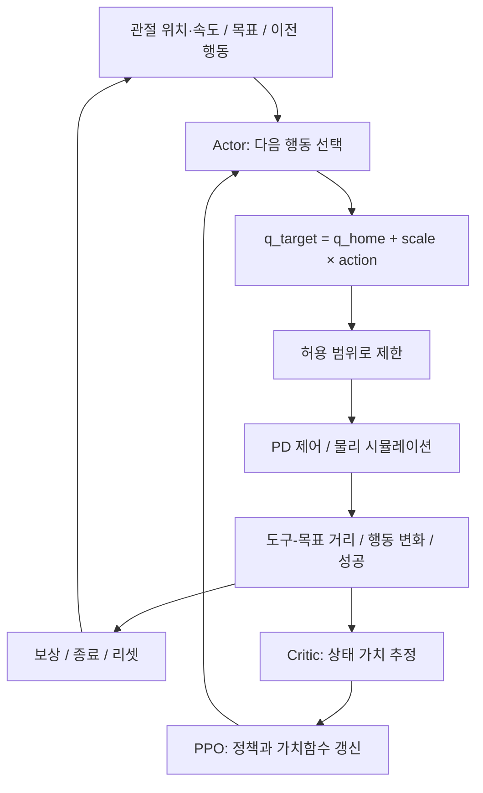

# 파일별 역할과 함수 작성

## 어디를 수정할지

| 파일 | 하는 일 | 내 로봇에 맞춰 수정 |
|---|---|---|
| assets/demo_arm.urdf | 3축 테스트 팔의 기구·질량·한계 | 별도 my_arm.urdf 사용 |
| configs/demo_robot.json | 관절·PD·목표 범위 | my_robot.json으로 복사 후 전 필드 |
| scripts/inspect_urdf.py | 입력 파일을 읽고 JSON 보고서 생성 | 보통 수정 불필요 |
| src/arm_practice/urdf.py | 이름·트리·관절 한계 검사 | 필요 시 메시·관성 검사 추가 |
| scripts/convert_urdf.sh | EA 공식 변환기 실행 | 입력·출력 인자만 변경 |
| src/arm_practice/core.py | NumPy 행동·보상 계산 실습 | 수식이 주는 결과 비교 |
| src/arm_practice/tasks/__init__.py | Gym 태스크 등록 | 새 과제 추가 시 ID 구분 |
| src/arm_practice/tasks/reach_cfg.py | 내 USD·행동·목표·성공 조건 연결 | 집기·센서·접촉·리셋 확장 |
| src/arm_practice/tasks/ppo_cfg.py | 공식 PPO 설정 재사용 | 환경당 스텝·반복 수·네트워크 |
| scripts/lab.sh | 버전 고정 후 CLI 실행 | 일반적으로 수정 불필요 |

## 관측 → 행동 → 물리 → 보상

`q`는 관절값, 회전 관절은 rad, 직선 관절은 m입니다. Actor(액터)는 행동을 선택하는 신경망, Critic(크리틱)은 상태의 기대 누적 보상을 추정하는 신경망입니다. PPO(피피오)는 새 정책이 한 번에 너무 크게 바뀌지 않도록 갱신 폭을 제한하는 강화학습 방법입니다. RSL-RL(알에스엘 알엘)은 PPO 실행을 제공하는 라이브러리입니다.

## 행동 함수

CPU 예제는 `joint_targets(action, home, scale, lower, upper)`입니다. 관절 순서대로 1차원 배열을 받고, 길이·NaN·범위를 검사합니다. 정규화 행동을 `[-1,1]`로 제한한 뒤 home에 변화량을 더하고 최종 관절 한계를 적용합니다.

Lab에서는 `JointPositionActionCfg`가 같은 변환을 담당합니다. 이 API의 `clip`은 **변환 이후의 값**에 적용됩니다. 따라서 `clip=(-1,1)`을 무조건 넣지 않고 `max(lower,home-scale)`부터 `min(upper,home+scale)`까지 지정했습니다. 회전·직선 관절이 섞이면 각 관절의 단위와 scale도 다릅니다.

## 보상과 성공 판정

CPU 연습 수식은 다음과 같습니다.

`r = -||p_tcp-p_goal||₂ - 0.01||a_t-a_(t-1)||₂² + 2·1[distance≤0.03]`

가까워지면 거리 감점이 줄고, 갑작스러운 행동 변화는 감점하며, 3cm 안쪽이면 보너스를 줍니다. 이 함수는 수식을 이해하는 CPU 예제입니다. Lab 태스크는 공식 ReachEnvCfg의 거리·행동·속도 보상을 사용하므로 **두 보상 숫자를 직접 비교하지 않습니다.**

Lab의 `position_success`는 도구 거리만 판단합니다. 3축 팔에 불가능한 자세를 요구하지 않도록 방향 보상과 방향 성공 조건을 제거했습니다. 한 프레임 도달만으로 성공하므로 실제 집기 과제에는 다음을 추가합니다.

| 함수/설정 | 입력 | 출력 | 집기 확장 |
|---|---|---|---|
| observation | 관절·목표·센서 | batch×관측 차원 | 물체 자세·집게 상태·접촉 |
| action | batch×행동 차원 | 관절 목표 | 집게 열기/닫기 행동 |
| reward | 거리·접촉·물체 높이 | 환경별 실수 | 잡기·들기·놓기 단계별 보상 |
| success | 도구/물체 상태 | 환경별 bool | 지정 영역에서 일정 시간 유지 |
| termination | 제한·시간·실패 | terminated/truncated | 낙하·충돌·과도한 힘 종료 |
| reset | 종료된 환경 ID | 해당 환경만 초기화 | 충돌 없는 물체·팔 배치 |

배치 환경을 다룰 때 `.item()`으로 첫 환경 하나만 평가하거나 Python `if`로 전체 배치를 묶지 않습니다. Tensor 비교로 환경별 결과를 반환합니다. 3.0의 ProxyArray 데이터는 필요한 경우 `.torch`로 접근합니다. quaternion은 이 버전의 XYZW 순서를 따릅니다.

## 정책을 실제 팔로 옮길 때

학습 중 관측 순서, 정규화 통계, action scale, PD 계수, 제어 주기를 저장합니다. 실제 로봇에서도 같은 입출력을 구성해야 합니다. 이 저장소는 특정 모터의 드라이버나 실물 정책 배포기를 제공하지 않습니다. 내 구동기 인터페이스에 맞춘 `ros2_control` 구현과 정지 처리가 필요합니다.

공식 API: [EA ReachEnvCfg](https://github.com/isaac-sim/IsaacLab/blob/v3.0.0-EA/source/isaaclab_tasks/isaaclab_tasks/core/reach/reach_env_cfg.py), [행동 설정](https://github.com/isaac-sim/IsaacLab/blob/v3.0.0-EA/source/isaaclab/isaaclab/envs/mdp/actions/actions_cfg.py), [공식 PPO 설정](https://github.com/isaac-sim/IsaacLab/blob/v3.0.0-EA/source/isaaclab_tasks/isaaclab_tasks/core/reach/config/franka/agents/rsl_rl_ppo_cfg.py).
