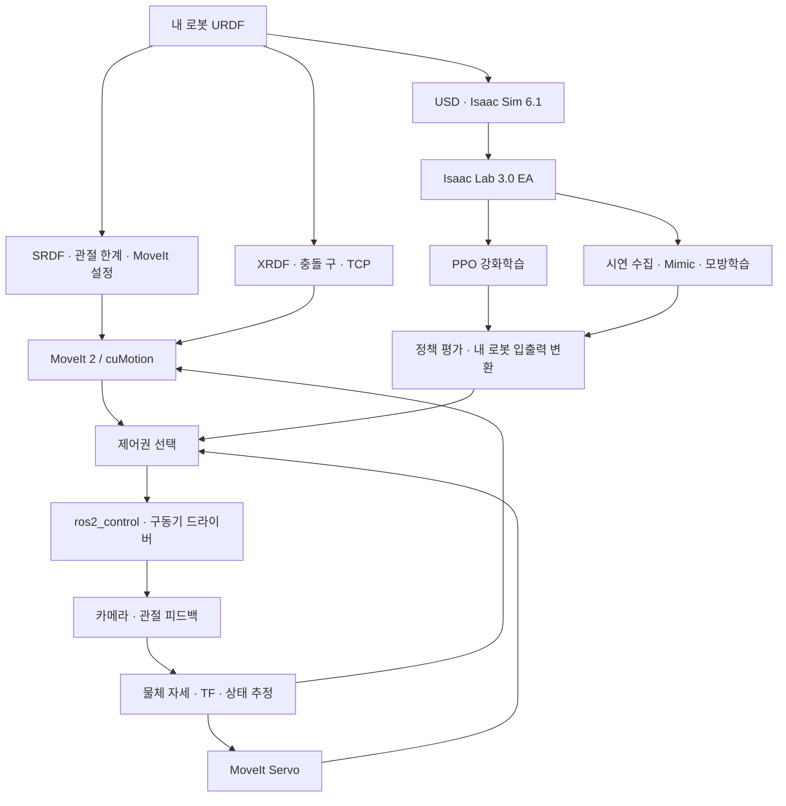

# 직접 만든 로봇팔 제어와 정책학습

Ubuntu 24.04 · ROS 2 Lyrical · Isaac ROS 5.0 · Isaac Sim 6.1 · Isaac Lab 3.0 EA

작성 기준: 2026-10-30. 대상은 각자 만든 로봇팔 URDF입니다. 설치, 경로계획, 시뮬레이션, 강화학습, 모방학습을 순서대로 진행합니다. 이 자료의 명령은 Ubuntu Bash용입니다.

## 1. 버전부터 고정하기

| 구성 | 이 실습의 기준 | 역할 / 확인할 점 |
|---|---|---|
| 운영체제 | Ubuntu 24.04 LTS, x86_64 | 학습용 PC 기준. Jetson 설치 명령과 구분 |
| ROS | ROS 2 Lyrical LTS | Isaac ROS Buildfarm의 Ubuntu 24.04용 패키지 사용 |
| 인식·계획 | Isaac ROS 5.0 | cuMotion, 객체 자세 추정, nvblox 등 |
| 로봇 시뮬레이터 | Isaac Sim 6.1.0 | USD, 관절, 물리, 센서, ROS 연결 |
| 학습 프레임워크 | Isaac Lab `v3.0.0-EA` | Sim 6.1에 대응하는 3.0 태그 |
| 학습 실행 | EA 태그의 `uv.lock` | Python 3.12, RSL-RL 등 의존성을 함께 유지 |
| 전통 제어 | Lyrical용 MoveIt 2·ros2_control·Servo | 실제 설치된 패키지 버전도 기록 |
| VLA 확장 | 별도 GR00T 환경 | Lab 가상환경과 합치지 않음 |

**Isaac Lab 3.0 정식 `v3.0.0`과 EA는 다릅니다.** 현재 정식 릴리스는 Sim 6.2를 대상으로 합니다. Sim 6.1을 유지하는 이 실습에서는 `v3.0.0-EA`를 사용합니다. `main`, `release/3.0.0`처럼 움직이는 브랜치로 바꾸지 않습니다. EA를 정식 또는 LTS라고 표시하지 않습니다.

또한 Sim 6.1의 공식 ROS 브리지 지원표는 Humble·Jazzy를 권장하며, 다른 네이티브 ROS 배포판 로드는 실험적 지원입니다. 따라서 **Lyrical용 제어 환경 설치**와 **Sim 6.1 ↔ Lyrical 통신 검증**을 별도 단계로 관리합니다. 이 문서는 해당 조합의 실제 GPU 통합 실행을 완료했다는 보증서가 아닙니다.

공식 근거: [Lab EA 버전표](https://github.com/isaac-sim/IsaacLab/tree/v3.0.0-EA), [현재 Lab 버전표](https://github.com/isaac-sim/IsaacLab#isaac-sim-compatibility), [Sim 6.1 ROS 지원](https://docs.isaacsim.omniverse.nvidia.com/6.1.0/installation/install_ros.html), [Isaac ROS 5.0](https://nvidia-isaac-ros.github.io/v/release-5.0/getting_started/index.html).

## 2. 전체 구조



경로계획은 이동 경로를 계산합니다. 컨트롤러는 그 경로를 시간에 맞춰 따라갑니다. 정책은 관측을 받아 행동을 선택합니다. 세 기능을 같은 것으로 취급하지 않습니다. cuMotion·Servo·정책이 한 관절에 동시에 명령하지 않도록 실행 모드를 하나만 선택합니다.

## 3. 제어·학습 방법별 사용처

| 방법 | 입력 → 출력 | 적합한 작업 | 직접 준비할 것 |
|---|---|---|---|
| MoveIt 2 + cuMotion | 시작 관절·목표 자세·장애물 → 궤적 | 집기 위치까지 충돌을 피한 이동 | URDF, SRDF, XRDF, 컨트롤러 |
| MoveIt Servo | 자세/속도 보정 명령 → 짧은 관절 명령 | 카메라를 보면서 마지막 위치 보정 | TF, 현재 관절, 명령 주기 |
| MoveIt Task Constructor | 작업 단계 → 단계별 계획 | 접근·잡기·들기·놓기 | 단계별 성공·실패 조건 |
| 임피던스·어드미턴스 | 힘·변위·속도 → 힘 또는 운동 명령 | 접촉·삽입·순응 동작 | 센서, 구동기 제어 기능, 안정성 확인 |
| PPO 강화학습 | 관측·보상 → 정책 가중치 | 반복 시행착오로 제어 전략 학습 | 관측·행동·보상·리셋·종료 함수 |
| BC / ACT / Diffusion Policy | 시연 영상·상태·행동 → 정책 | 사람이 보여준 집기 동작 학습 | 시간 동기화된 시연 데이터 |
| GR00T VLA | 영상·언어·로봇 상태 → 행동 | 지시를 조건으로 여러 조작 작업 | 내 로봇 데이터·modality 설정 |
| VLA의 RL 추가학습 | 사전학습 정책·보상 → 보정된 정책 | 특정 작업 성공률 개선 연구 | 별도 RLinf 조합과 재현 검증 |

이는 역할에 따른 선택표입니다. 가장 최근 모델이 모든 로봇·작업에서 가장 좋은 것은 아닙니다. 성공률, 실패 원인, 지연, 데이터 비용을 같은 조건에서 비교합니다. cuRoboV2는 직접 GPU 계획기를 연구할 때 비교할 수 있지만, 현재 cuMotion의 내부 구현과 같은 라이브러리라고 가정하지 않습니다.

참고: [MoveIt Servo](https://moveit.picknik.ai/main/doc/examples/realtime_servo/realtime_servo_tutorial.html), [MTC](https://moveit.picknik.ai/main/doc/tutorials/pick_and_place_with_moveit_task_constructor/pick_and_place_with_moveit_task_constructor.html), [어드미턴스](https://control.ros.org/lyrical/doc/ros2_controllers/admittance_controller/doc/userdoc.html), [cuRobo](https://github.com/NVlabs/curobo), [GR00T](https://github.com/NVIDIA/Isaac-GR00T).

## 4. 내 로봇에서 먼저 적을 값

| 파일·항목 | 작성 내용 | 통과 기준 |
|---|---|---|
| URDF / xacro | 링크, 관절 축, 원점, collision, 질량·관성 | 화면의 움직임이 실제 관절 방향과 같음 |
| 관절 목록 | 학습·제어에 사용할 이름과 순서 | 이름으로 대응하며 배열 순서를 추측하지 않음 |
| 관절 한계 | 위치 rad 또는 m, 속도, 가속도, effort | 모터·감속기·기구의 실제 한계를 반영 |
| TCP | 물체를 잡는 기준 링크와 변환 | 손목 중심과 집게 끝을 구분 |
| SRDF | arm/gripper 그룹, home 자세, 충돌 제외 | 필요한 충돌쌍이 무조건 제외되지 않음 |
| XRDF | cspace, tool frame, 충돌 구 | 실제 링크와 집게 외형을 충분히 덮음 |
| USD | articulation, 충돌, drive, 센서 | 무명령 상태와 단일 관절 동작이 정상 |
| 컨트롤러 | 관절명, command/state interface, action 이름 | 피드백이 실제 값으로 계속 갱신됨 |
| 학습 입출력 규격 | 관측 순서·단위·정규화, 행동 의미, 주기 | 시뮬레이션과 실기에 같은 변환 적용 |

6축 로봇이나 특정 모터를 가정하지 않습니다. 4축 팔은 임의의 6D 자세를 모두 만들 수 없으므로, 도달 가능한 위치와 자세를 목표로 설정해야 합니다.

## 5. Lyrical 제어 환경 설치

### 5-1. 호스트 준비

Docker와 NVIDIA Container Toolkit이 아직 없다면 함께 제공한 [Ubuntu 준비 절차](PREREQUISITES_UBUNTU24.04.md)의 Docker 절차부터 실행합니다. 기존 YOLO 실습의 Isaac ROS 5.0 환경이 정상이라면 재설치하지 않습니다.

```bash
cat /etc/os-release
nvidia-smi
docker run --rm --gpus all ubuntu:24.04 nvidia-smi
export ISAAC_ROS_WS="$HOME/workspaces/isaac_ros-dev"
mkdir -p "$ISAAC_ROS_WS/src"
isaac-ros activate
```

마지막 줄 이후는 컨테이너 터미널입니다. 호스트의 Lab 가상환경을 여기서 활성화하지 않습니다.

### 5-2. 패키지 확인·설치 — 컨테이너

```bash
printenv ROS_DISTRO
test "$ROS_DISTRO" = lyrical
sudo apt-get update
apt-cache policy ros-lyrical-moveit ros-lyrical-moveit-servo \
  ros-lyrical-isaac-ros-cumotion-examples
```

후보 버전이 `(none)`이면 저장소 설정부터 고칩니다. Jazzy 패키지를 대신 섞어 설치하지 않습니다.

```bash
sudo apt-get install -y \
  ros-lyrical-moveit ros-lyrical-moveit-setup-assistant \
  ros-lyrical-moveit-servo ros-lyrical-ros2-control \
  ros-lyrical-ros2-controllers ros-lyrical-xacro \
  ros-lyrical-robot-state-publisher \
  ros-lyrical-isaac-ros-cumotion-examples
ros2 pkg prefix moveit_setup_assistant
ros2 pkg prefix moveit_servo
ros2 pkg prefix isaac_ros_cumotion
ros2 pkg prefix isaac_ros_cumotion_moveit
```

MoveIt은 ROS 배포판에 맞춘 패키지를 사용합니다. 임의의 Rolling 소스를 같은 overlay에 추가하지 않습니다. Isaac ROS 5.0 릴리스 노트에는 일부 로봇 제조사 패키지의 Lyrical 이행 문제도 명시되어 있습니다.

출처: [cuMotion 설치](https://nvidia-isaac-ros.github.io/v/release-5.0/repositories_and_packages/isaac_ros_cumotion/isaac_ros_cumotion_moveit/index.html), [5.0 릴리스 노트](https://nvidia-isaac-ros.github.io/v/release-5.0/releases/index.html).

### 5-3. 내 URDF로 MoveIt 설정 만들기

```bash
ros2 launch moveit_setup_assistant setup_assistant.launch.py
```

1. Create New MoveIt Configuration Package에서 자신의 URDF를 불러옵니다.
2. Self-Collisions를 계산하고 실제 충돌할 수 있는 링크가 제외되지 않았는지 검토합니다.
3. 고정식 팔이면 world와 base의 고정 관계를 정의합니다. 이동식 팔은 이동 베이스 TF와 중복하지 않습니다.
4. arm 그룹에 실제 구동 관절의 체인을 지정합니다. gripper는 별도 그룹으로 둡니다.
5. TCP, home 자세, ros2_control의 command/state interface를 작성합니다.
6. 컨트롤러의 관절명과 MoveIt action 경로를 맞춥니다.
7. 예를 들어 `my_arm_moveit_config`라는 이름으로 workspace의 `src`에 저장합니다.

아래 패키지 이름은 예시입니다. 생성한 이름과 다르면 바꿉니다.

```bash
cd "$ISAAC_ROS_WS"
rosdep install --from-paths src --ignore-src -r -y
colcon build --symlink-install --packages-up-to my_arm_moveit_config
source install/setup.bash
ros2 launch my_arm_moveit_config demo.launch.py
```

RViz에서 먼저 OMPL로 Plan을 확인합니다. Execute는 가상 컨트롤러·시뮬레이터·실기 중 어느 대상으로 연결됐는지 확인한 뒤 실행합니다. RViz의 가상 로봇이 움직였다고 실제 모터 드라이버가 완성된 것은 아닙니다.

출처: [Setup Assistant](https://moveit.picknik.ai/main/doc/examples/setup_assistant/setup_assistant_tutorial.html).

### 5-4. cuMotion 연결

XRDF에는 내 로봇의 관절 공간과 충돌 구가 필요합니다. URDF 파일명만 바꾼 Franka XRDF는 내 로봇 설정이 아닙니다. Sim의 Robot Description Editor 등으로 외형을 덮는 충돌 구를 작성하고, TCP와 관절 순서를 확인합니다.

```bash
ROBOT_MOVEIT_CONFIG_DIR="$ISAAC_ROS_WS/src/my_arm_moveit_config"
cp "$(ros2 pkg prefix --share isaac_ros_cumotion_moveit)/config/isaac_ros_cumotion_planning.yaml" \
  "$ROBOT_MOVEIT_CONFIG_DIR/config/"
```

자신의 MoveIt launch에서 `MoveItConfigsBuilder`가 읽는 planning pipelines에 `ompl`과 `isaac_ros_cumotion`을 포함시킵니다. YAML이 `move_group` 파라미터로 실제 전달되도록 해야 합니다. 리스트 이름만 추가하고 설정 파일을 로드하지 않으면 플러그인이 동작하지 않습니다.

새 컨테이너 터미널에서 실행합니다. 파일·링크 이름을 자신의 값으로 수정합니다.

```bash
source "$ISAAC_ROS_WS/install/setup.bash"
ROBOT_URDF="$ISAAC_ROS_WS/src/my_arm_description/urdf/my_arm.urdf"
ROBOT_XRDF="$ISAAC_ROS_WS/src/my_arm_description/config/my_arm.xrdf"
TOOL_FRAME="tool0"
test -f "$ROBOT_URDF" && test -f "$ROBOT_XRDF"
ros2 launch isaac_ros_cumotion isaac_ros_cumotion.launch.py \
  cumotion_action_server.xrdf_file_path:="$ROBOT_XRDF" \
  cumotion_action_server.urdf_file_path:="$ROBOT_URDF" \
  cumotion_action_server.read_esdf_world:=false \
  cumotion_action_server.tool_frame:="$TOOL_FRAME"
```

이 단계에서는 nvblox가 없으므로 ESDF 사용을 끕니다. 이후 깊이 카메라의 외부 파라미터·시각 동기화·로봇 제거·ESDF 서비스까지 준비한 뒤 켭니다. 물체를 집으면 attachment와 충돌 모델도 갱신합니다.

출처: [커스텀 로봇팔 cuMotion](https://nvidia-isaac-ros.github.io/v/release-5.0/concepts/manipulation/cumotion_moveit/tutorial_custom_manipulator.html).

## 6. Isaac Sim 6.1 + Lab 3.0 EA 설치 — 별도 호스트 터미널

ROS 컨테이너 밖에서 실행합니다. `.venv-yolo`나 GR00T 환경과 합치지 않습니다. 아래는 태그의 `pyproject.toml`과 `uv.lock`을 함께 사용하는 경로입니다. EA 웹 문서 일부에 최신 Sim 설치 명령이 섞여 있어, 본 실습은 **EA 소스 태그의 `isaacsim==6.1.0.0` 지정**을 기준으로 합니다.

`uv`가 없다면 [공식 설치](https://docs.astral.sh/uv/getting-started/installation/) 후 새 터미널을 엽니다.

```bash
sudo apt-get update
sudo apt-get install -y git git-lfs build-essential cmake
git lfs install
mkdir -p "$HOME/robot_learning"
cd "$HOME/robot_learning"
git clone --branch v3.0.0-EA --depth 1 \
  https://github.com/isaac-sim/IsaacLab.git IsaacLab-3.0-EA
cd IsaacLab-3.0-EA
git describe --tags --exact-match
uv sync --frozen --extra isaacsim
uv run --frozen --extra isaacsim python -c \
  "from importlib.metadata import version; print('isaacsim',version('isaacsim')); print('torch',version('torch')); print('rsl-rl-lib',version('rsl-rl-lib'))"
```

통과 기준: 태그가 `v3.0.0-EA`, Isaac Sim이 `6.1.0.0`입니다. `--frozen`은 저장된 lock을 유지합니다. 해결 실패 시 lock을 지우거나 `--upgrade`로 넘어가지 말고 플랫폼·드라이버·로그를 확인합니다. 최초 Sim 실행에는 라이선스 동의 절차가 나타날 수 있습니다.

### 6-1. 설치 확인용 학습

```bash
cd "$HOME/robot_learning/IsaacLab-3.0-EA"
uv run --frozen --extra isaacsim isaaclab list_envs
uv run --frozen --extra isaacsim isaaclab train \
  --rl_library rsl_rl --task Isaac-Cartpole-Direct \
  physics=isaacsim_physx
```

Cartpole은 환경 설치 확인용입니다. 최종 실습은 자기 로봇으로 진행합니다. `physics=isaacsim_physx`를 명시해야 이 경로에서 Sim의 PhysX를 사용합니다. 기본 Newton 실행만 성공한 상태와 구분합니다. 최초 실행은 셰이더·자산 준비로 오래 걸릴 수 있습니다. 실행 로그의 실제 저장 경로에서 checkpoint가 생겼는지 확인하고 종료합니다.

```bash
uv run --frozen --extra isaacsim isaaclab play \
  --rl_library rsl_rl --task Isaac-Cartpole-Direct \
  --checkpoint /absolute/path/to/model_checkpoint.pt \
  physics=isaacsim_physx
```

`/absolute/path/...`를 학습 로그에 나온 실제 파일로 바꿉니다. 다른 task의 checkpoint는 사용하지 않습니다.

출처: [EA 설치](https://isaac-sim.github.io/IsaacLab/v3.0.0-EA/source/setup/installation/index.html), [EA 의존성](https://github.com/isaac-sim/IsaacLab/blob/v3.0.0-EA/pyproject.toml).

## 7. 내 로봇 학습 환경 작성

```bash
cd "$HOME/robot_learning/IsaacLab-3.0-EA"
uv run --frozen --extra isaacsim isaaclab --new
```

생성기에서 외부 프로젝트, manager-based single-agent, 최소 stub, RSL-RL/PPO를 선택합니다. 생성기의 README에 따라 해당 프로젝트를 editable 설치합니다. 이후 `isaaclab list_envs`에서 자신의 task ID가 보여야 합니다. 아래 파일 이름은 역할을 설명하기 위한 권장 이름이며, 생성된 패키지 구조에 맞춰 배치합니다.

| 작성 파일 | 작성할 내용 | 시험 방법 |
|---|---|---|
| `robot_cfg.py` | 내 USD, 관절 선택, 초기 자세, 구동기 모델 | 단일 관절 부호·한계 검사 |
| `env_cfg.py` | 로봇·바닥·물체·카메라·작업 공간 | 목표가 실제 도달 범위 안에 있음 |
| `observations.py` | 현재 관절, 속도, TCP 오차, 물체 위치 | 단위·좌표계·차원·NaN 검사 |
| `actions.py` 또는 action cfg | 관절 목표 증분 또는 TCP 증분 | 행동 0과 작은 양·음 입력 비교 |
| `rewards.py` | 접근·성공 보상, 충돌·큰 행동 변화 비용 | 성공 상태의 보상이 더 높은지 검사 |
| `events.py` | 초기화, 물체 위치·마찰·질량 변동 | 리셋 후 겹침·비정상 자세 없음 |
| `terminations.py` | 성공, 낙하, 한계 초과, 시간 종료 | 실패 종료와 시간 제한을 구분 |
| `agents/rsl_rl_ppo_cfg.py` | 정책망·학습률·rollout·저장 주기 | 작은 배치에서 로그·저장·재생 확인 |
| `__init__.py` | task ID 등록 | 목록에서 내 task 검색 |

### 7-1. 함수 설계의 출발점

관측은 실제 센서로 재현할 수 있는 정보로 설계합니다. 시뮬레이터의 정답 물체 좌표로 먼저 학습했다면, 실기에서는 추정 오차가 포함된 좌표로 바꾸고 다시 평가합니다.

```text
observation = [관절 위치, 관절 속도, TCP→목표 오차, 집게 상태, 이전 행동]
action = 관절 목표의 증분(rad) 또는 TCP 이동 증분(m, rad)
q_target = clip(q_reference + scale * action, q_min, q_max)
reward = -w_d * 거리 -w_a * 행동변화제곱 -w_c * 충돌 +w_s * 성공
```

`q_reference`가 현재 위치인지 고정 기준 자세인지 명시합니다. 서로 바꾸면 완전히 다른 제어기가 됩니다. 계수 `w_d`, `w_a`, `w_c`, `w_s`는 단위와 크기를 비교해서 정하며, 예시 숫자를 모든 로봇에 복사하지 않습니다. 성공은 거리만이 아니라 필요한 자세·물체 유지·정지 상태도 포함할 수 있습니다.

PPO(Proximal Policy Optimization, 피피오)는 한 번에 정책이 너무 크게 바뀌지 않도록 확률비를 제한하며 개선하는 알고리즘입니다. RSL-RL(알에스엘 알엘)은 이를 실행하는 학습 라이브러리입니다. 정책은 `관측 → 행동` 함수이며, PPO와 정책 자체는 다른 개념입니다.

검증 순서: **무행동 → 제한된 임의 행동 → 짧은 학습 → 저장 모델 재생 → 학습에 쓰지 않은 초기조건 평가**. 이후 물체 위치, 마찰, 센서 잡음, 제어 지연을 실제 범위 안에서 바꿉니다.

출처: [EA 프로젝트 생성](https://isaac-sim.github.io/IsaacLab/v3.0.0-EA/source/developer-tools/template_generator.html), [RSL-RL](https://github.com/leggedrobotics/rsl_rl).

## 8. 시연으로 배우기: Mimic·모방학습·VLA

### Mimic의 역할

사람이 성공 동작을 시연하고 접근·집기·들기·놓기의 구간을 표시합니다. 각 구간의 물체 기준 좌표를 이용해 새로운 물체 배치로 궤적을 옮기고, 시뮬레이션에서 성공한 궤적을 데이터로 남깁니다. 무조건 성공 시연을 무한히 생성하는 기능은 아닙니다. 자기 로봇에는 작업 구간, 물체 프레임, 성공 판정, 행동 형식을 직접 연결해야 합니다.

기록할 값: 영상 시간, 관절 상태, TCP, 집게, 행동, 물체 상태, 성공 여부, 작업 지시문. 학습·평가는 프레임 단위로 섞지 말고 시연 에피소드와 촬영 세션을 나눕니다.

### 정책 종류

- BC(비씨): 시연의 관측을 보고 시연 행동을 맞추는 기본 방법.
- ACT(에이씨티): 미래 여러 시점의 행동을 묶어 예측하는 방식.
- Diffusion Policy(디퓨전 폴리시): 잡음에서 행동 시퀀스를 점차 복원하는 방식.
- VLA(브이엘에이): 영상·언어·행동을 연결하는 모델 계열. 모델의 출력 형식은 별도로 확인해야 함.

이들은 설치 후 이름만 바꾸면 같은 정책이 되는 것이 아닙니다. 데이터 형식, 행동 표현, 예측 길이, 실행 주기를 맞춰야 합니다.

### GR00T 별도 환경 — 확장 실습

최신 모델 연구는 기본 Lab 설치와 분리합니다. 아래 revision은 조사 시 확인한 GR00T N1.7 GA 저장소 상태를 고정한 것입니다. Sim 6.1용 모든 예제가 검증됐다는 의미는 아닙니다.

```bash
cd "$HOME/robot_learning"
git clone --recurse-submodules https://github.com/NVIDIA/Isaac-GR00T.git
cd Isaac-GR00T
git checkout c56f54128d92f743889b7e4cecfc1ceafd88739e
git submodule update --init --recursive
uv sync --python 3.12
uv run python gr00t/experiment/launch_finetune.py --help
```

자신의 로봇 데이터는 고정한 저장소의 `getting_started/finetune_new_embodiment.md`와 `data_preparation.md`에 맞춥니다. 카메라 이름, state/action 배열, 절대값·증분, 관절·TCP 표현을 `modality_config`로 정의합니다. 모델 접근 권한·라이선스 동의가 필요한 경우 본인 계정에서 처리합니다. 학습용 GPU 메모리는 추론보다 훨씬 많이 필요합니다.

**VLA의 RL 추가학습은 선택 연구 과제입니다.** Isaac Lab의 RLinf 예제는 특정 GR00T·transformers 버전에 고정되어 있으며, 최신 N1.7 환경에 그대로 합칠 수 없습니다. 예제의 고정 revision을 별도 환경에서 재현한 뒤 자기 로봇으로 옮깁니다.

출처: [Mimic EA](https://isaac-sim.github.io/IsaacLab/v3.0.0-EA/source/features/imitation-learning/teleop_imitation.html), [GR00T 새 로봇 학습](https://github.com/NVIDIA/Isaac-GR00T/blob/c56f54128d92f743889b7e4cecfc1ceafd88739e/getting_started/finetune_new_embodiment.md), [RLinf 실험 기능](https://isaac-sim.github.io/IsaacLab/v3.0.0-EA/source/experimental-features/rlinf_vla_posttraining.html).

## 9. Lyrical과 Sim 6.1 연결 검증

**Lyrical을 Jazzy로 바꾸지 않습니다.** 제어 노드는 Isaac ROS 5.0/Lyrical에서 실행합니다. Sim 6.1은 기본 학습에 ROS가 필요하지 않으므로 먼저 독립 실행을 검증합니다. 연결이 필요한 단계에서 아래를 확인합니다.

1. `sensor_msgs/JointState`, `trajectory_msgs/JointTrajectory`, TF, `/clock` 등 필요한 인터페이스 목록을 정합니다.
2. Sim 쪽 ROS 브리지가 어떤 배포판의 라이브러리를 로드했는지 로그로 기록합니다. Lyrical 라이브러리를 불러오는 경로는 공식 문서상 실험적입니다.
3. 네이티브 Lyrical을 Sim 프로세스에서 쓸 경우 Ubuntu 24.04용 Isaac ROS Buildfarm으로 준비하고, 새 터미널에서 `/opt/ros/lyrical/setup.bash`만 source합니다. 컨테이너 안의 라이브러리 경로를 호스트에 복사해 연결하지 않습니다.
4. 같은 ROS_DOMAIN_ID와 호환 RMW·네트워크·QoS를 설정합니다. 서로 다른 배포판 사이의 DDS 통신이 일부 된다고 전체 API 호환을 보장하지 않습니다.
5. `/clock`, 관절 상태, TF를 먼저 수신합니다. 실제 브리지에 설정한 명령 토픽으로 작은 단일 관절 목표를 보내고 응답·단위·시간을 확인합니다.
6. custom message가 있으면 양쪽 정의와 Python 3.12 빌드 조건을 일치시킵니다. Action·서비스도 각각 시험합니다.

Lyrical 제어 터미널에서 실행하는 읽기 전용 확인 명령:

```bash
printenv ROS_DISTRO
ros2 topic list -t
ros2 topic info /joint_states --verbose
ros2 topic echo /joint_states --once
ros2 topic hz /joint_states
ros2 topic echo /clock --once
ros2 action list -t
ros2 control list_controllers
```

`ros2 topic hz`는 Ctrl+C로 종료합니다. 네임스페이스가 있으면 토픽 이름을 바꿉니다. 토픽이 없거나 오래된 상태라면 실행을 허용하지 않습니다. Sim 연결이 미확인인 경우에도 Lyrical에서 가상 ros2_control 또는 실제 드라이버를 이용한 계획·제어 검증, 독립 Lab 학습은 따로 진행할 수 있습니다.

## 10. 실제 팔로 옮길 때 맞춰야 하는 것

학습과 배포의 관측 이름·순서·단위·정규화·프레임을 동일하게 유지합니다. 정책 출력이 관절 목표인지 TCP 증분인지 확인합니다. TCP 출력은 IK 또는 Servo 변환이 필요하며, 이를 관절 배열로 바로 보내지 않습니다. 학습 때의 물리 주기와 정책 갱신 주기, 실기 지연을 기록합니다.

각 모드의 진입·종료 조건을 정의합니다. 상태 정보가 오래되거나, 정책 값이 NaN이거나, 관절 한계·통신 조건을 만족하지 않으면 정지 또는 유지 상태로 전환합니다. 정책 실행은 독립된 속도·위치 제한을 통과해야 합니다. Isaac ROS Deploy/LEAPP도 자기 로봇의 관측·행동 변환기를 작성해야 하며 URDF만 넣으면 완성되는 것은 아닙니다.

출처: [Isaac ROS Deploy](https://nvidia-isaac-ros.github.io/v/release-5.0/repositories_and_packages/isaac_ros_deploy/index.html).

## 11. 오류 대응과 완료 기준

| 현상 | 먼저 확인할 것 | 조치 |
|---|---|---|
| apt 후보 없음 | ROS_DISTRO, release-5.0 저장소 | Lyrical Buildfarm 환경부터 수정 |
| cuMotion 플러그인 오류 | MoveIt ABI, YAML 로드, overlay | 배포판 일치·실제 로드된 패키지 경로 확인 |
| 계획은 되는데 실행 실패 | controller action, 관절명, 피드백 | 가상/실기 연결 상태와 인터페이스 수정 |
| URDF는 보이지만 학습 시 발산 | 질량·관성, drive, 단위, 관절 부호 | 단일 관절부터 다시 확인 |
| Lab에서 Sim 6.2가 설치됨 | 태그, 활성 환경, lock | EA 전용 폴더·환경으로 복귀 |
| GPU 메모리 부족 | 병렬 환경 수, 카메라·해상도 | 작은 환경 수로 원인 분리 |
| 보상은 늘지만 작업 실패 | 성공 판정과 보상 항목 | 보상 편법을 찾고 실제 성공률을 별도 측정 |
| 정책 재생 시 엉뚱한 관절 | joint order, scale, action 의미 | 이름 기반 매핑과 정규화 비교 |
| Lyrical에서 Sim 토픽 없음 | 브리지 로그, RMW, domain, QoS | 송수신을 작은 메시지부터 검증 |
| 최신 VLA를 설치하니 Lab 깨짐 | 같은 venv 여부 | 환경 분리·각 저장소의 의존성 복구 |

완료 산출물: 내 URDF/USD/SRDF/XRDF, controller 설정, 학습 환경 코드, 버전 기록, checkpoint, 평가표, 실패 장면, 계획·학습·실기 각각의 실행 로그. 영상에는 사용한 방법과 평가 조건을 표시합니다.

```bash
# ROS 컨테이너에서
dpkg-query -W 'ros-lyrical-*' > "$ISAAC_ROS_WS/ros-packages.txt"
```

```bash
# Lab 호스트 폴더에서
cd "$HOME/robot_learning/IsaacLab-3.0-EA"
git rev-parse HEAD > lab-revision.txt
uv pip freeze > lab-packages.txt
```

**검증 범위:** 자료와 코드 블록의 정적 검사를 수행합니다. Ubuntu GPU 설치, Sim↔Lyrical 브리지, 실제 로봇 제어·학습 성능은 대상 장비에서 별도로 확인해야 합니다.
