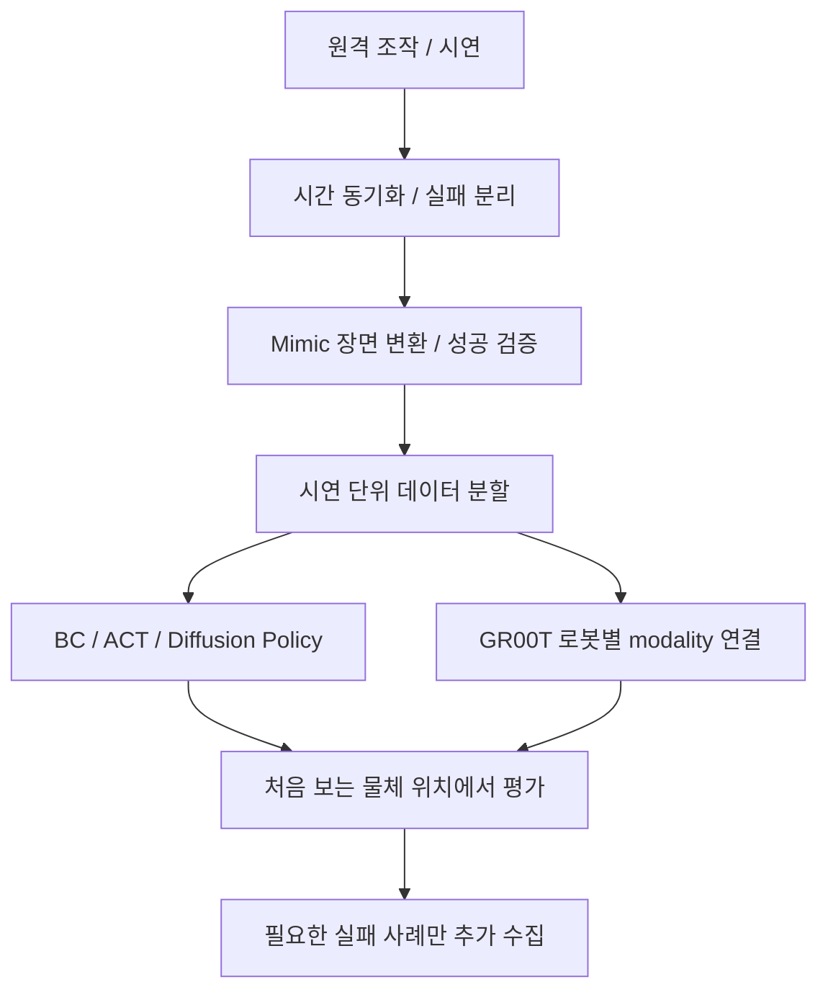

# PPO 다음 단계: 시연과 정책학습

모든 방법을 한 환경에 동시에 설치하기보다, 같은 로봇의 입력·출력 계약을 유지한 채 비교합니다.

| 방법 | 필요한 데이터 | 학습하는 것 | 첫 실습 |
|---|---|---|---|
| PPO | 시뮬레이션 관측·행동·보상 | 누적 보상을 높이는 정책 | 이 저장소의 위치 도달 |
| BC | 사람이 성공한 상태·행동 쌍 | 시연 행동을 재현 | 같은 상태에서 같은 행동 예측 |
| ACT | 연속 시연 구간 | 여러 미래 행동 묶음 | 집기 동작의 시간 일관성 |
| Diffusion Policy | 시연 영상·상태·행동 | 행동 시퀀스의 분포 | 여러 가능한 집기 경로 |
| Mimic | 소수 시연+장면 정보 | 시연을 바탕으로 데이터 증강 | 물체 위치를 바꾼 시연 생성 |
| GR00T VLA | 영상·언어·상태·행동 | 지시와 시각을 조건으로 행동 | 자기 로봇 데이터로 미세조정 |

BC는 Behavior Cloning(비헤이비어 클로닝), ACT는 Action Chunking with Transformers(액션 청킹 위드 트랜스포머스), VLA는 Vision-Language-Action(비전 랭귀지 액션)입니다. Mimic은 학습 알고리즘 자체보다 데이터 생성 과정에 해당합니다.

## 시연 데이터 계약

각 timestep에 카메라 프레임·시간·관절 상태·명령·물체 자세·성공 여부를 기록합니다. 관절 순서와 단위, 이미지 해상도, 카메라 보정값, 행동이 절대값인지 변화량인지 메타데이터로 남깁니다. 실패 시연은 성공 시연과 구분합니다. train/validation/test는 같은 동작의 인접 프레임을 무작위로 섞지 않고 시연 단위로 나눕니다.

## 자기 로봇으로 GR00T 준비

1. 카메라 키, joint state 키, action 키, 언어 지시 키를 정의합니다.
2. 관절 기반 정책인지 TCP 기반 정책인지 정합니다. 모델이 내 구동기 명령을 자동으로 아는 것은 아닙니다.
3. 기록한 시연을 해당 GR00T revision의 데이터 형식으로 변환합니다.
4. modality config와 normalization을 검토합니다.
5. 별도 환경에서 fine-tuning 후 보류한 시연·새 배치에서 평가합니다.

설치 revision과 복사할 명령은 [설치 가이드의 GR00T 절](INSTALL.md)에 있습니다. 이 저장소에는 내 로봇 데이터가 없으므로 GR00T 학습 완료 모델을 제공하지 않습니다. RL 추가학습은 보상·시뮬레이션·지원 모델 버전을 다시 맞추는 후속 실습입니다.

공식 참고: [Isaac Lab Mimic](https://isaac-sim.github.io/IsaacLab/main/source/overview/imitation-learning/isaaclab_mimic.html), [Isaac GR00T](https://github.com/NVIDIA/Isaac-GR00T), [RSL-RL](https://github.com/leggedrobotics/rsl_rl).
